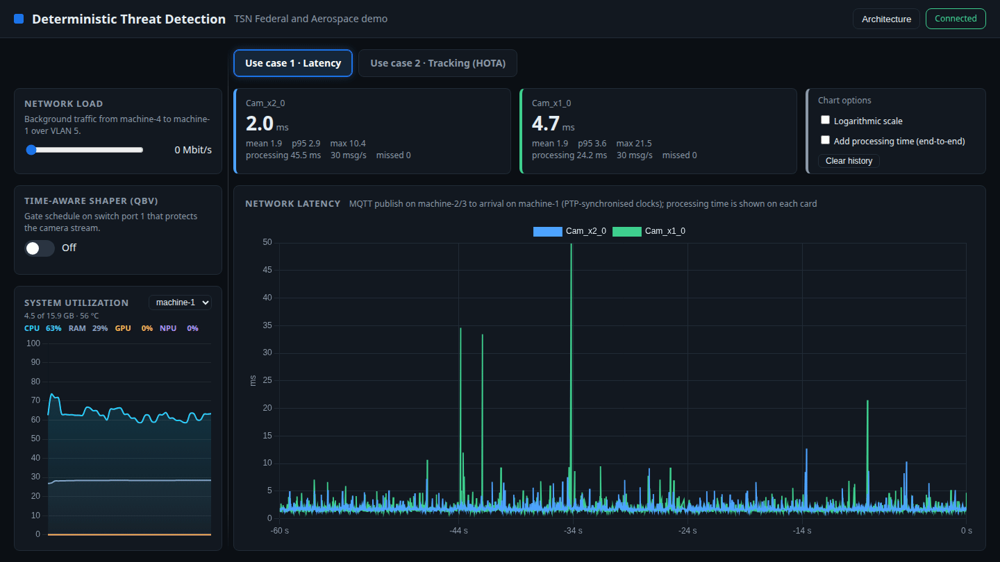
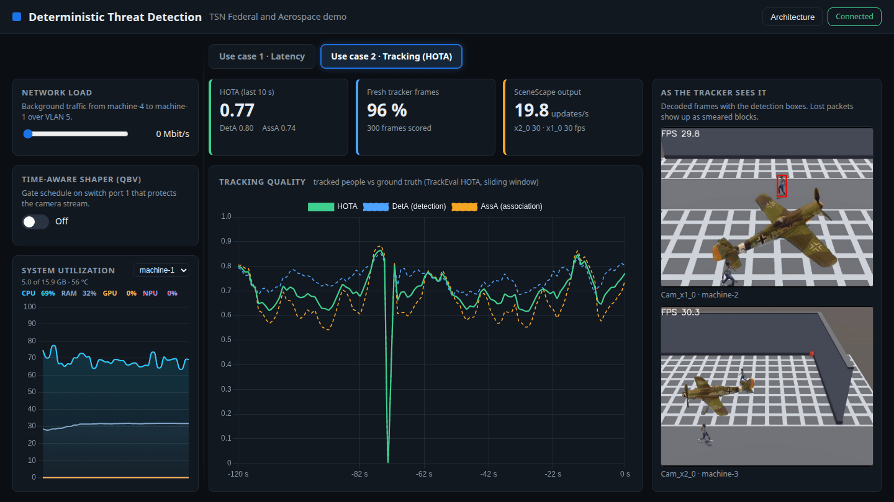

# Deterministic Threat Detection with Time-Sensitive Networking (TSN) - Preview

Shows how a Time-Sensitive Networking switch keeps AI video workloads deterministic while the
network is flooded with background traffic. One web dashboard, two use cases:

| Use case | What it shows | Metric |
|----------|---------------|--------|
| **1 - Latency** | Two cameras run AI inference and publish the results over MQTT | One-way network latency per message |
| **2 - Tracking** | SceneScape fuses two camera views into tracked people | Live HOTA score (test videos) or tracker rate (Basler cameras) |

A slider on the dashboard injects load (UDP, up to 1 Gbit/s) from a fourth machine. A toggle enables the
IEEE 802.1Qbv Time-Aware Shaper on the switch. With the shaper off the load starves both use cases;
with it on they are not affected.





## Quick start

You need four Linux machines and a Moxa TSN switch ([System requirements](./docs/user-guide/system-requirements.md)).
Set up the machines, VLANs, PTP and the switch once: [First-time setup](./docs/user-guide/first-time-setup.md).
Then, on machine-1:

```bash
git clone https://github.com/open-edge-platform/federal-and-aerospace-ai-suite.git
cd federal-and-aerospace-ai-suite/deterministic-threat-detection
cp lab.env.example lab.env      # fill in the addresses (once, see First-time setup, step 6)
make up                         # test videos; or: make up SOURCE=basler
make down
```

No git on machine-1? Download the archive instead:

```bash
curl -OjL https://github.com/open-edge-platform/federal-and-aerospace-ai-suite/releases/download/fedaero-latest/deterministic-threat-detection.zip
unzip deterministic-threat-detection.zip
cd deterministic-threat-detection
```

> [!NOTE]
> The documentation assumes paths relative to the
> `federal-and-aerospace-ai-suite/deterministic-threat-detection` directory.
> If you used the ZIP archive, replace
> `federal-and-aerospace-ai-suite/deterministic-threat-detection` with the
> path to your extracted `deterministic-threat-detection` folder wherever it
> appears in the guides.

Then open `https://<machine-1 lab address>/dashboard/`. [Get started](./docs/user-guide/get-started.md)
explains the dashboard and what to try.

## Layout

| Path | Runs on | What |
|------|---------|------|
| `src/dashboard/` | machine-1 | Web UI, backend, MQTT broker |
| `src/scene/` | machine-1 | SceneScape, DL Streamer Pipeline Server, mediamtx, nginx |
| `src/camera-node/` | machines 2 and 3 | Test-video RTSP publishers, camera inference pipelines |
| `src/traffic-node/` | machine-4 | Load agent (iperf3) and metrics |
| `src/switch/` | machine-2 (remote) | Moxa switch scripts (Qbv, port priority, PTP profile) |
| `src/setup/` | every machine | One-time NIC/VLAN and PTP setup scripts |
| `src/data/` | | Test videos, ground truth, model config (the model itself is downloaded by `make up`) |
| `docs/user-guide/` | | Documentation |

## Documentation

- [First-time setup](./docs/user-guide/first-time-setup.md) (once per machine)
- [Get started](./docs/user-guide/get-started.md)
- [System requirements](./docs/user-guide/system-requirements.md)
- [How-to guides](./docs/user-guide/how-to-guides.md): Moxa switch, PTP, Basler cameras
- [Release notes](./docs/user-guide/release-notes.md)

## Tests

```bash
make test        # dashboard unit tests (no hardware needed)
make test-e2e    # SceneScape end-to-end test (needs `make up` running with the test videos)
```
