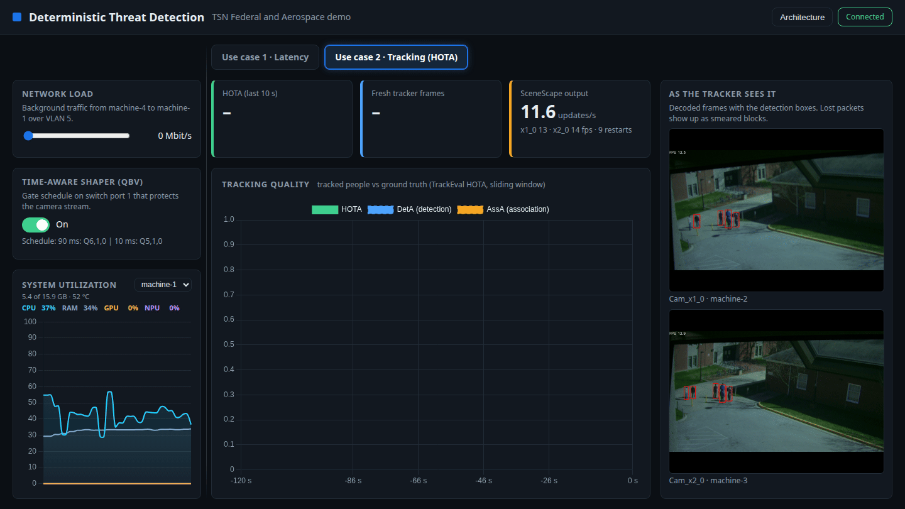
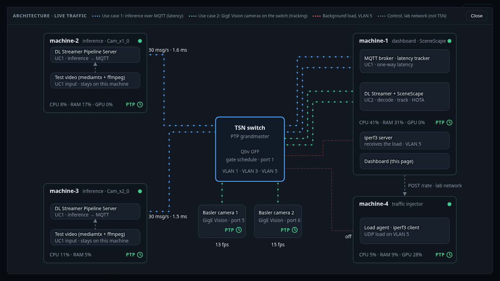
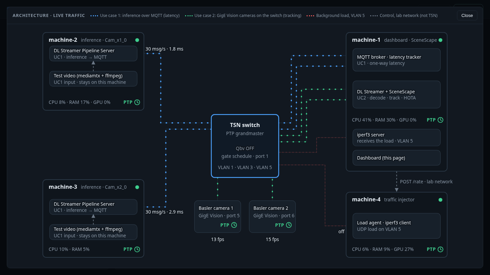
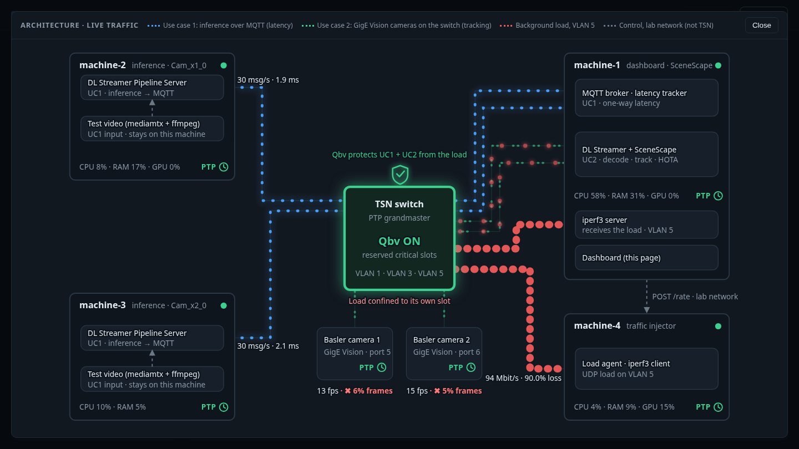

# Integrate Basler Cameras with SceneScape

Use two Basler GigE cameras as the sources for use case 2. This project does not ship the image
with the Basler camera SDK: you build it once yourself (below). After that `make up SOURCE=basler`
does the wiring.

> **License notice:** the pylon SDK is proprietary software under Basler's own license terms (see
> <https://www.baslerweb.com/en/downloads/software/>). It is not part of this project and not
> covered by its Apache-2.0 license. By building the image you accept Basler's terms. Build it
> locally for your own cameras and do not publish or redistribute it. `gst-plugin-pylon`
> (BSD-3-Clause) and `gencamsrc` (Apache-2.0) are open source.

## Prepare (once)

1. Configure the cameras: [Configure Basler PTP timestamps](./configure-basler-ptp-timestamps.md).
2. Create VLAN 3 on machine-1 ([First-time setup](../../first-time-setup.md)); the cameras sit in
   VLAN 3 on switch ports 5 and 6.
3. Give the camera ports priority 0. Untagged camera frames take the port's priority; priority 3
   would put the camera video in the same queue as other VLAN 3 traffic and starve MQTT
   under the Qbv schedule. Run on machine-2 after `make -C src/dashboard deploy-switch`
   (`<switch address>` is `SWITCH_IP` from `lab.env`):

   ```bash
   python3 -I ~/moxa/port_priority.py set --host <switch address> --ports 5,6 --value 0
   python3 -I ~/moxa/port_priority.py get --host <switch address> --ports 5,6
   ```

4. Build the pipeline server image with the camera SDK. The standard DL Streamer Pipeline Server
   image has neither the pylon SDK nor the `gencamsrc` GStreamer source. Follow
   [Integrate Pylon SDK, Step 2: Create the Docker Image](https://docs.openedgeplatform.intel.com/dev/edge-ai-suites/ai-suite-manufacturing/industrial-edge-insights-vision/pallet-defect-detection/how-to-guides/integrate-camera-sdks.html#step-2-create-the-docker-image),
   using the image from `DLSTREAMER_PIPELINE_SERVER_IMAGE` in `src/scene/.env` as the base, with
   these points:

   - Tag the result `tsn-dlstreamer-pipeline-server-basler:<SCENESCAPE_VERSION>` (the value from
     `src/scene/.env`). `make up SOURCE=basler` stops
     with a message if this image does not exist.
   - Build `gencamsrc` with `-DGENCAMSRC_ENABLE_HW_TIMESTAMP_META=ON`. It then attaches the
     camera's PTP hardware timestamp to every frame (`GstReferenceTimestampMeta`), which the
     SceneScape adapter uses as the frame time. This worked with the `edge-ai-libraries`
     mainline at commit `cc2ac98fb0d3de12e5b12db37ce8fea34aa4d75a`.
   - Install the pylon runtime (7.5 was used) and `gst-plugin-pylon`.
   - Install the build tools for `gencamsrc` (`cmake`, `make`, `g++` and the GStreamer development
     packages). The current `ubuntu24` base image no longer contains `make`, so without it
     CMake fails with "unable to find a build program".
   - Behind a proxy that re-signs HTTPS traffic, download the `gst-plugin-pylon` `.deb` on the host
     and `COPY` it into the image: the GitHub release redirects to
     `release-assets.githubusercontent.com`, and `wget` inside the build then fails with a
     certificate error (exit code 5).
   - Set `GENICAM_GENTL64_PATH=/opt/pylon/lib/gentlproducer/gtl` and make sure `GST_PLUGIN_PATH`
     includes `/opt/intel/dlstreamer/lib`, `/opt/intel/dlstreamer/gstreamer/lib/gstreamer-1.0`,
     `/opt/intel/dlstreamer/gstreamer/lib`, `/usr/lib/x86_64-linux-gnu/gstreamer-1.0` and
     `/usr/local/lib/gstreamer-1.0`.
   - End the image with the base image's non-root user (`intelmicroserviceuser`).

5. In `src/scene/.env` set the camera serial numbers (the file is created from `.env.example` by
   the first `make up`; run `make up` once first if it does not exist yet) and, if needed, the
   macvlan address (it must be a free address in the VLAN 3 subnet):

   ```text
   BASLER_CAMERA1_SERIAL=<serial of camera 1>
   BASLER_CAMERA2_SERIAL=<serial of camera 2>
   BASLER_CONTAINER_IP=192.168.3.61
   BASLER_FPS=15
   ```

## Run

```bash
make up SOURCE=basler
make down
```

Always pass `SOURCE=basler` (a plain `docker compose up` has no camera plugin and the pipelines
fail with `no element "gencamsrc"`).



The Architecture view shows the two cameras on switch ports 5 and 6. With Qbv off, the load
starves them; with Qbv on, both keep their frame rate.







The dashboard shows the tracker rate and the decoded frames. HOTA is not meaningful here: there
is no ground truth and no frame number.

## What `make up SOURCE=basler` does

- Starts the pipeline server from your `tsn-dlstreamer-pipeline-server-basler` image.
- Attaches the container to a macvlan network on `tsn0.3` so it can reach the cameras.
- Runs `gencamsrc ... ! gvapython` with `src/scene/dlstreamer-pipeline-server/sscape_adapter.py`,
  which publishes the camera's PTP hardware timestamp as the frame time.

## Troubleshooting

- `Device::open()` fails: the camera is still held. `docker stop -t 30` the pipeline container,
  wait, then `make up SOURCE=basler` again.
- 1970 timestamps: the camera's PTP is not locked yet (timestamp 0 is ignored by the adapter).
- No cameras found: `ping 192.168.3.17` from machine-1 and check the camera IPs.
