# Handheld multi-modal application

An operator console for Intel edge devices: live camera analytics, evidence
search, mission documents, alerts and speech. It runs entirely on the device,
built from unmodified Open Edge Platform `release-2026.2.0` components plus an
application Backend and browser UI.


## Features

- **Live cameras**: YOLO26s INT8 detection (NPU) and tracking, annotated
  WebRTC video and evidence crops per track.
- **History**: browse tracks and ask questions such as "how many people on
  camera 2 in the last ten minutes?".
- **Mission**: upload PDF/DOCX orders; brief and answers from
  `Intel/neural-chat-7b-v3-3` (GPU) via stock Chat Q&A.
- **Alerts**: operator rules dispatched by the Alert Agent and spoken by
  SpeechT5 (CPU; `make speech-device TTS_DEVICE=GPU` to switch).
- **Voice**: push-to-talk questions transcribed by Whisper-medium (GPU).
- **Resources**: CPU, memory, GPU, NPU and power telemetry.

## Quick start

Requires an Intel GPU/NPU host (`/dev/dri/renderD128`, `/dev/accel/accel0`),
Docker Compose 2.24.4+, GNU Make, Python 3.11+, curl and OpenSSL. The first
start downloads several GB of models; later starts run offline.

```sh
export HF_TOKEN=hf_...   # optional, only if Hugging Face rate-limits downloads
make demo-up             # start with looping demo cameras (also restarts)
make up                  # or start without demo cameras
make                     # list all commands (status, stop, tests, ...)
```

Open `https://localhost:8443/` on the device and trust `config/tls/server.crt`.
`make demo-mission` loads the example mission from `examples/`. For offline
installs see
[Copy to another device](docs/application/application-operations.md#copy-to-another-device-offline).

## Remote access

Every port binds to `127.0.0.1`. From a laptop, forward the UI and TURN ports:

```sh
ssh -N -L 8443:127.0.0.1:8443 -L 3478:127.0.0.1:3478 <user>@<device-address>
```

Then open `https://localhost:8443/` on the laptop. Keep both local port
numbers: the proxy accepts only `localhost:8443` origins, and live video is
relayed over TURN/TCP on 3478 (SSH carries no UDP).

If the page loads but camera tiles stay black:

- check the `ssh` output for `bind ... Address already in use` on 3478;
- on the laptop, `nc -vz 127.0.0.1 3478` (Windows:
  `Test-NetConnection 127.0.0.1 -Port 3478`) must succeed;
- `chrome://webrtc-internals` (Firefox: `about:webrtc`) must show a `relay`
  candidate; managed browser policies can block it.

The tunnel grants full, unauthenticated UI access: do not share it
(`ssh -g`, `GatewayPorts`).

## Components

| Service | Image | Role |
|---|---|---|
| DL Streamer Pipeline Server | `intel/dlstreamer-pipeline-server:2026.2.0-ubuntu24` | Detection, tracking, annotated WebRTC, MQTT, crops |
| Chat Q&A Core | `intel/chatqna:core_gpu_2026.2.0` | Mission documents and answers |
| Audio Analyzer | `intel/audio-analyzer:2026.2.0` | Speech-to-text (Whisper-medium, GPU) |
| Text To Speech | `intel/text-to-speech:2026.2.0` | Spoken alerts and answers (SpeechT5) |
| Alert Agent | `intel/alert-agent-service:2026.2.0` | Rule-mode alert dispatch, no LLM |
| Metrics Manager | `intel/metrics-manager:2026.2.0` | Hardware telemetry |
| Model Download | `intel/model-download:2026.2.0` | Prepares the YOLO26s IR (first start) |
| MediaMTX | `bluenviron/mediamtx:1.11.3` | RTSP input, WHIP/WHEP relay |
| Coturn | `coturn/coturn:4.18.0` | Loopback-only TURN for tunnelled browsers |
| Mosquitto | `eclipse-mosquitto:2.0.22` | MQTT between DLSPS and Backend |
| nginx | `nginx:1.27-alpine` | TLS proxy on `127.0.0.1:8443` |
| FFmpeg | `jrottenberg/ffmpeg:6.1-ubuntu2404` | Demo cameras only |
| Backend + UI | `handheld/backend:dev` (built from `backend/`) | Application logic; calls stock APIs only |

[](docs/images/architecture.svg)

The Backend is never in the video path. The running app also serves an
interactive architecture page at `/architecture.html`.

## Documentation

| Topic | Where |
|---|---|
| Operator guide | [docs/OPERATOR_GUIDE.md](docs/OPERATOR_GUIDE.md) |
| Operations and deployment | [docs/application/application-operations.md](docs/application/application-operations.md) |
| Components, versions, endpoints | [COMPONENTS.md](COMPONENTS.md), [MANIFEST.yaml](MANIFEST.yaml) |
| Status | [STATUS.md](STATUS.md) |
| Model provenance | [MODEL_PROVENANCE.md](MODEL_PROVENANCE.md) |
| Design | [docs/design/APPLICATION_DESIGN.md](docs/design/APPLICATION_DESIGN.md) |
| Contributor and agent rules | [AGENTS.md](AGENTS.md) |

Demo videos: intel-iot-devkit sample (CC BY 4.0) and Pexels video 34622113
(Pexels License). The mission packet in `examples/` is synthetic.
