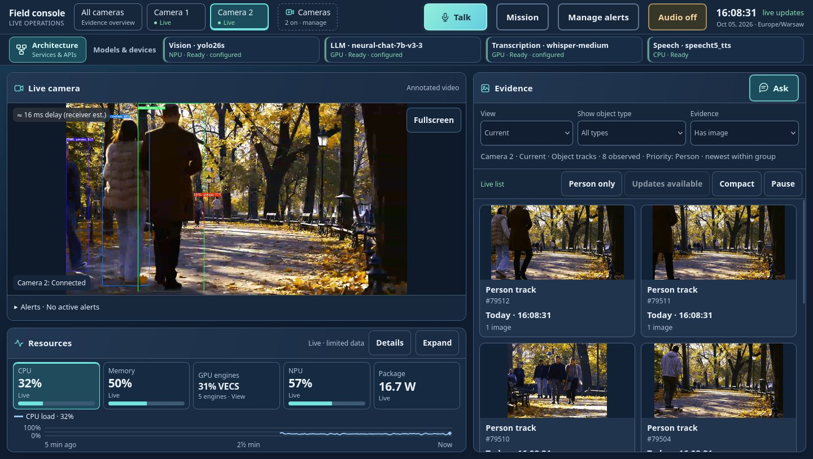

<!--
SPDX-FileCopyrightText: (C) 2026 Intel Corporation
SPDX-License-Identifier: Apache-2.0
-->
# Handheld Multi-Modal Application

The Handheld Multi-Modal application is an operator console for Intel® edge devices that fuses
live camera analytics, evidence search, mission documents, alerts, and speech. It runs entirely
on the device and is built from unmodified Open Edge Platform `release-2026.2.0` microservices,
plus an application Backend and browser UI. Models are downloaded on the first start; after that,
all inference runs locally, the application works offline, and data does not leave the device.

The application can be deployed on top of the Edge Node Infrastructure software - an edge
computing platform, which enables hardware acceleration capabilities. See
[Infrastructure Setup](docs/user-guide/infrastructure-setup.md) for build and provisioning steps.



## Features

- **Live cameras**: YOLO26s INT8 detection (NPU) and tracking, annotated WebRTC video, and
  evidence crops per track.
- **History**: browse tracks and ask questions such as "how many people on camera 2 in the last
  ten minutes?".
- **Mission**: upload PDF/DOCX orders; brief and answers from `Intel/neural-chat-7b-v3-3` (GPU)
  through Chat Q&A.
- **Alerts**: operator rules dispatched by the Alert Agent and spoken by SpeechT5 (CPU; run
  `make speech-device TTS_DEVICE=GPU` to switch).
- **Voice**: push-to-talk questions transcribed by Whisper-medium (GPU).
- **Resources**: CPU, memory, GPU, NPU, and power telemetry.

## Project Structure

```text
Makefile                     Lifecycle, readiness check, offline bundle, and test targets (run `make` for the list).
AGENTS.md                    AI agent context file.
compose/                     Docker Compose files: application services and demo camera publishers.
backend/                     Application Backend (FastAPI) and browser UI; built locally as handheld/backend:dev.
config/                      Per-service configuration: DLSPS pipelines and detector profile, Chat Q&A, proxy, TURN, MQTT, metrics, speech.
scripts/                     Demo asset preparation, live readiness checks, and smoke tests.
examples/                    Synthetic demo mission packet and an Intel® RealSense™ RTSP publisher script.
.agents/skills/              AI agent skills for the application and its Open Edge Platform microservices.
MODEL_PROVENANCE.md          Source, license, and verification of every model.
third-party-components.spdx  Software bill of materials of third-party components.
```

## Stack

| Service | Image | Role |
|---------|-------|------|
| DL Streamer Pipeline Server | `intel/dlstreamer-pipeline-server:2026.2.0-ubuntu24` | Detection, tracking, annotated WebRTC, MQTT, crops |
| Chat Q&A Core | `intel/chatqna:core_gpu_2026.2.0` | Mission documents and answers |
| Audio Analyzer | `intel/audio-analyzer:2026.2.0` | Speech-to-text (Whisper-medium, GPU) |
| Text To Speech | `intel/text-to-speech:2026.2.0` | Spoken alerts and answers (SpeechT5) |
| Alert Agent | `intel/alert-agent-service:2026.2.0` | Rule-mode alert dispatch, no LLM |
| Metrics Manager | `intel/metrics-manager:2026.2.0` | Hardware telemetry |
| Model Download | `intel/model-download:2026.2.0` | Prepares the YOLO26s IR (first start) |
| MediaMTX | `bluenviron/mediamtx:1.11.3` | RTSP input, WHIP/WHEP relay |
| Coturn | `coturn/coturn:4.18.0` | Loopback-only TURN for tunneled browsers |
| Mosquitto | `eclipse-mosquitto:2.0.22` | MQTT between DLSPS and Backend |
| NGINX | `nginx:1.27-alpine` | TLS reverse proxy on `127.0.0.1:8443` |
| FFmpeg | `jrottenberg/ffmpeg:6.1-ubuntu2404` | Demo cameras only |
| Backend + UI | `handheld/backend:dev` (built from `backend/`) | Application logic; calls the microservice APIs only |

[](docs/user-guide/_assets/architecture.svg)

The Backend is never in the video path. The running application also serves an interactive
architecture page at `/architecture.html`.

## Prerequisites

| Requirement | Notes |
|-------------|-------|
| Intel® GPU and NPU | `/dev/dri/renderD128` and `/dev/accel/accel0` with the Intel GPU and NPU drivers installed. |
| Docker Engine and Docker Compose 2.24.4 or later | [Install guide](https://docs.docker.com/engine/install/). Use `docker compose` (space). |
| GNU Make, Python 3.11 or later, curl, OpenSSL | Used by the Make lifecycle. |
| Disk space and Internet access | The first start downloads several GB of models; later starts run offline. |

### Optional Hugging Face Token

Export `HF_TOKEN` only if Hugging Face rate-limits the model downloads. Do not add the token to
`.env` or commit it to version control.

```bash
export HF_TOKEN=hf_...
```

## Quick Start

```bash
cd handheld-multi-modal
make demo-up       # start with looping demo cameras (run again to restart)
make up            # or start without cameras; add them in the console
make demo-mission  # optional: load the example mission from examples/
make               # list all commands (status, stop, check, tests, ...)
```

Open <https://localhost:8443/> on the device and trust `config/tls/server.crt`. For offline
installs, see
[Copy to Another Device](docs/user-guide/application-operations.md#copy-to-another-device-offline).

## Endpoints

Every published port binds to `127.0.0.1`. The console has no authentication. For remote
access, use an SSH tunnel as described in
[Access Application User Interface](docs/user-guide/access-application.md#remote-access-through-an-ssh-tunnel).

| Service | URL | Notes |
|---------|-----|-------|
| Operator console | https://localhost:8443 | Through the NGINX TLS reverse proxy |
| Architecture page | https://localhost:8443/architecture.html | Interactive service diagram |
| TURN relay | `127.0.0.1:3478` (TCP) | Live video for tunneled browsers |
| RTSP input | `rtsp://127.0.0.1:8554/<camera>` | Local camera publishers |

## Make Targets

```text
make prereq / demo-prereq       Check host tools and devices, download models (and demo videos)
make up / demo-up               Start the application (demo-up also starts demo cameras)
make demo-mission               Load the example mission document
make status                     Services and per-camera feed health
make check                      Read-only readiness check of images, models, and services
make stop                       Stop every service
make pipelines-restart          Restart Backend and DLSPS; language models stay loaded
make speech-device TTS_DEVICE=  Move SpeechT5 to CPU or GPU
make down                       Remove containers; keep models, history, and TLS
make bundle / bundle-load       Copy the prepared application to offline devices
make clean / clean-demo         Remove generated configuration / demo assets
make clean-history CONFIRM=yes  Remove tracks, evidence, rules, alerts, and missions
make clean-all CONFIRM=yes      Remove everything above plus models, caches, and TLS keys
make test / test-ui / test-assets / test-fuzz / test-history
```

## Documentation

- [User Guide](docs/user-guide/index.md)
- [Deploy the Application](docs/user-guide/deploy-applications.md)
- [Access Application User Interface](docs/user-guide/access-application.md)
- [Operator Guide](docs/user-guide/operator-guide.md)
- [Application Operations](docs/user-guide/application-operations.md)
- [Model Provenance](MODEL_PROVENANCE.md)
- [Release Notes](docs/user-guide/release-notes.md)

Demo videos: intel-iot-devkit sample (CC BY 4.0) and Pexels video 34622113 (Pexels License).
The mission packet in `examples/` is synthetic.
