# Operator guide

Open `https://<device>:8443` and accept the self-signed certificate.
Red numbers in the pictures match the numbered lists below.

The console is one fixed landscape screen: live camera and alerts on the left,
evidence and the assistant on the right, resources below. It uses a dark navy
theme with teal for primary actions (Talk, Ask, selected camera), amber for
alerts and warnings, and red only for a recording Talk button or failures.
The reference display is a 1280×800 handheld touch screen: everything fits
without page scrolling, and the layout grows with larger screens. Main
actions (Talk, Mission, Manage alerts, Audio, camera tabs, Acknowledge, View,
Speak, Send) are 48 px tall and every other button at least 44 px, so they
are easy to press by finger. Tapping a drop-down opens a list of large rows
next to it; tap a row to choose it, or tap outside to keep the current value. Run the browser full screen (F11 or
kiosk mode) on the handheld.

## Contents

- [Top bar](#top-bar)
  - [Model details](#model-details)
- [All cameras](#all-cameras)
- [Adding and removing cameras](#adding-and-removing-cameras)
  - [Adding a camera](#adding-a-camera)
  - [Network camera](#network-camera)
  - [Publisher camera address](#publisher-camera-address)
  - [Editing and removing](#editing-and-removing)
- [Live camera and alerts](#live-camera-and-alerts)
  - [Viewing an alert](#viewing-an-alert)
- [Evidence](#evidence)
  - [While you were away](#while-you-were-away)
  - [Evidence details](#evidence-details)
- [Ask (assistant)](#ask-assistant)
  - [How the assistant answers](#how-the-assistant-answers)
- [Mission](#mission)
- [Rules](#rules)
  - [Creating an alert](#creating-an-alert)
  - [How rules match](#how-rules-match)
  - [Drawing a zone](#drawing-a-zone)
- [Resources](#resources)
- [Voice questions and spoken answers](#voice-questions-and-spoken-answers)
  - [Listening](#listening)
  - [Spoken answers](#spoken-answers)
  - [How voice works](#how-voice-works)
  - [Recovering a question](#recovering-a-question)

## Top bar

1. **Camera tabs** — pick the live camera. The last camera you used is
   restored on the next visit. **All cameras** shows the live grid (below).
   A yellow badge counts open alerts. With many cameras the tab strip scrolls
   sideways; a fade on the right means more tabs.
2. **Talk** — ask a question by voice (see
   [Voice questions](#voice-questions-and-spoken-answers)). While listening it
   turns red and reads **Send question**.
3. **Mission** — mission documents and brief (see [Mission](#mission)).
4. **Manage alerts** — alert rules (see [Rules](#rules)).
5. **Audio off / Audio on** — tap once so the browser may play spoken
   alerts and answers. Amber means off; green means on. Speech is silent
   until you tap it. Turning it on announces alerts that still need
   attention (for example, ones that fired while it was off). Tapping
   **Audio on** turns it off and silences any speech that is playing.
6. **Clock** — local time; "live updates" means the UI is connected.
   **Connection lost · retrying** means data may be stale until it reconnects.
7. **Models & devices** — each model with its device and status (Vision on
   NPU, LLM and Transcription on GPU, Speech on CPU). Click one for details.
   Transcription uses whisper-medium with FP16 weights; Speech uses the voice Miles.
8. **Architecture** — opens the architecture page (below) in place;
   **Back to app** returns to the console.

### Architecture page

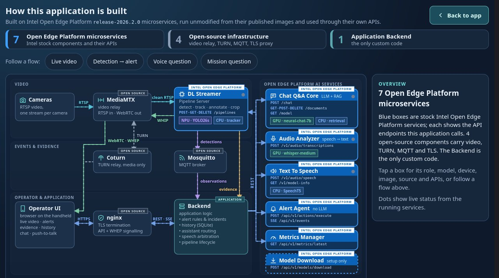

A diagram of every service and how data moves between them, coloured by
interface (RTSP, WebRTC WHIP/WHEP, TURN, MQTT, evidence images, HTTPS/REST/SSE).
Each box is tagged by origin: **Intel Open Edge Platform** boxes have a solid
blue title bar, are the stock Intel microservices and list the API endpoints the
application calls; grey
**Open source** boxes are the media, messaging and TLS infrastructure; the
**Application** Backend is the only custom code. The three counters at the top
highlight each group. Tap a service to highlight its connections and show its
role, APIs, model, device, image and source; tap it again or tap anywhere
outside the boxes (or press Escape) to return to the full view. Dots show live
status.
**Follow a flow** highlights a whole path step by step: live video, detection to
alert, voice question or mission question. Below the diagram, **Where each model
runs** groups the models by NPU, GPU and CPU, **Open Edge Platform APIs used**
lists every endpoint called with source links, and the collapsed tables list
every service image and interface. **Back to app** returns.

### Model details

1. Clicked model (click again to close).
2. Status, model, device and host. **Close** hides it. **Starting** means the
   service has not answered yet since the application started; it may still be
   loading or downloading its model (the first start can take up to an hour).
   Questions asked meanwhile say the model isn't ready yet; try again later.

## All cameras

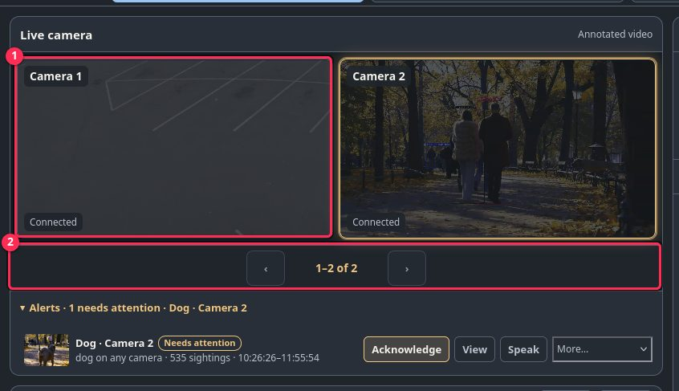

1. **Tile** — one camera, up to four per page. Tap to open that camera.
   Tiles with open alerts glow. Alert areas are drawn on each tile; an area
   whose alert is open pulses amber.
2. **‹ / ›** — next or previous four cameras (shown only with more than four).

## Adding and removing cameras

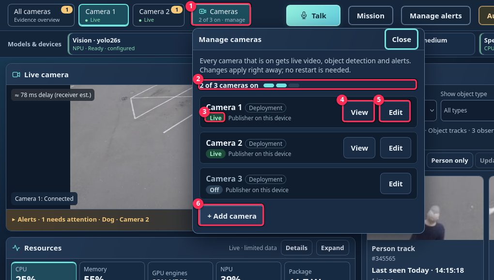

1. **Cameras** — in the top bar, right after the camera tabs. It shows how
   many cameras are on (for example "2 on"). Tap it to open **Manage
   cameras**.
2. **Count** — how many cameras are on (for example "2 cameras on").
3. **State** — **Live**, **Starting**, **No frames received**, **Signal
   lost** or **Off**. **Deployment** marks cameras set by the deployment.
4. **View** — show that camera's video and close the panel.
5. **Edit** — rename, turn off or remove the camera.
6. **+ Add camera** — opens the add form. There is no fixed camera limit; each
   camera that is on adds processor load, so check the device metrics after
   adding one.

### Adding a camera

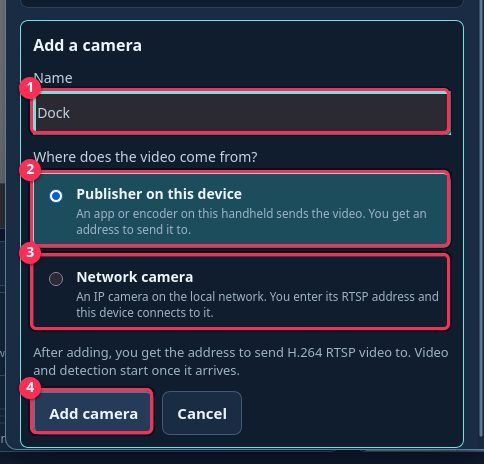

1. **Name** — what the camera is called in tabs, alerts and evidence.
2. **Publisher on this device** — an app or encoder on this handheld sends
   the video. You get the address after adding.
3. **Network camera** — an IP camera on the local network that this device
   connects to.
4. **Add camera** — or **Cancel** to close the form.

### Network camera

For a network camera, enter its address:

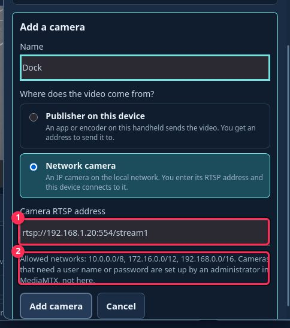

1. **Camera RTSP address** — the camera's `rtsp://` address.
2. **Note** — the allowed networks. Addresses outside them, or with a user
   name or password, are refused; an administrator sets those cameras up in
   MediaMTX instead.

### Publisher camera address

After adding a **publisher** camera, the panel shows where to send its video:

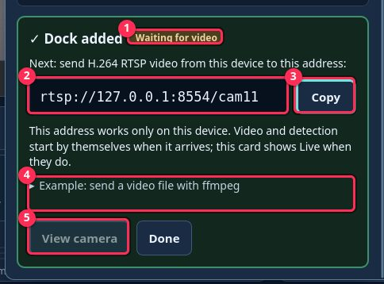

1. **Waiting for video** — nothing has arrived yet.
2. **Address** — send H.264 RTSP video here, for example
   `rtsp://127.0.0.1:8554/cam4`. It works only on this device.
3. **Copy** — copies the address for the publisher app.
4. **Example** — a ready ffmpeg command that sends a video file.
5. **View camera** — available once video arrives.

The card updates by itself when video arrives:

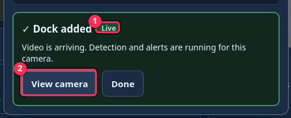

1. **Live** — video, detection and alerts are running.
2. **View camera** — switch to it. **Done** closes the card.

The address is also shown under **Edit** at any time.

### Editing and removing

1. **Name** and **Save name** — rename the camera.
2. **Address** and **Copy** — where to send video (publisher cameras).
3. **Turn off / Turn on** — stops or restarts its video and detection.
4. **Remove camera…** — asks to confirm:

1. **Remove** — removes the camera.
2. **Keep camera** — cancels.

Turning off or removing a camera keeps its recorded history and alerts. A
removed camera's name can be reused; its id never is. **Deployment** cameras
(`backend.yaml`, `make CAMERAS`) can only be renamed here. Alert rules on a
camera that was turned off or removed show **(camera off or removed)**; they
can be turned off or deleted, not turned back on.

No restart is needed; other open consoles pick up the change on their next
update. Every change is written to an audit log on the device.

## Live camera and alerts

Tap **Cameras** in the top bar to add, rename, turn off or remove cameras
(see above). New alerts update camera badges and highlights, and show a
banner over the top of the video ("Person in Gate area · Camera 2"). The banner
stays until you tap **View** or **Acknowledge** on it, or the alert closes;
several new alerts stack as "+N more". The alert's area pulses amber on the
video and grid tile, and the video gets an amber border. Tap **Alerts**
(the amber bar under the video) to open the list; it opens over the lower
part of the video and scrolls inside, so Resources stays in place. Tap
**Alerts** again to close it. Incoming alerts do not automatically expand it
or resize video.

1. Annotated video of the selected camera (boxes on detected objects). The
   small badge shows estimated video delay when available.
2. **Fullscreen** — enlarge the video.
3. **Alert** — object, camera, sightings, first–last time, state. Tap the
   picture or text to show the objects that raised it in Evidence. The small
   ⏱ time under the picture is how many seconds after the detector first saw
   the object the whole alert arrived (on screen, voice and picture). Hover
   or long-press it for each step. Alerts from before a Backend restart have
   no time. Video delay is the separate badge on the video.
4. **Acknowledge** — "I've seen it". First button, amber border. A new
   sighting reopens the alert.
5. **View** — same as tapping the alert.
6. **Speak** — say the alert now (needs Audio on). A soft chime plays first.
7. **More…** — Snooze 5 / 15 min, Dismiss, False alarm, Retry delivery,
   Disable rule, **Remove from list** (asks to confirm).

Speech labels: **spoken**, **not played (Audio off)**, **not spoken
(cooldown)**, **text only (speech unavailable)**.

### Viewing an alert

After **View** the Evidence panel shows only that alert:

1. **Back to live evidence** — return to the normal list.
2. Each object that matched the alert; click for images.

## Evidence

1. **View** — **Current** (on screen now), **History · priority** or
   **History · newest** (recorded tracks).
2. **Show object type** — only persons, cars, …
3. **Evidence** — **All records** or **Has image**.
4. **Person only** — show only priority objects.
5. **Compact / Cards** — switch between dense rows and image cards; the choice
   is remembered.
6. **Pause / Resume** — freeze the list; **Updates available** loads what
   arrived meanwhile.
7. **Object card / row** — click to open its images.
8. **Ask** — open the assistant.
9. **‹ Newer / Older ›** — History lists show 50 tracks per page; these
   buttons appear below the list when there are more. With All cameras, each
   page holds the next 50 tracks of every camera. Older pages are snapshots;
   page 1 stays live. Changing camera, view or filters returns to page 1.

### While you were away

A **While you were away** card appears after returning from five or more
minutes away. It summarizes at least the new alerts and track counts visible
through the existing history APIs; tap **View** to jump into them.

### Evidence details

1. **Back** — close the details.
2. The whole stored image (tap it for full screen), then camera, times and
   confidence; thumbnails switch images.

## Ask (assistant)

1. Type a question.
2. **Send**.
3. **Camera scope** — which camera's records. Follows the camera on screen
   (grid = **All cameras**), for typed and voice questions; pick another to
   override until you switch cameras.
4. **Answer mode** — **Ask anything** (records, mission or general) or
   **General chat** (no camera records).
5. **History filters** — object type and time range.
6. **Find person** — recorded priority objects, last 10 minutes.
7. **Mission objective** — from the loaded mission.
8. **Explain a topic** — general conversation.
9. **New conversation** — forget earlier questions.
10. **Back** — close the assistant.

### How the assistant answers

General chat remembers the last few exchanges and mission answers the last
three; camera answers do not. General answers never describe what is on camera.

Ask how the application itself works ("what runs on the NPU?", "how does video
reach my screen?") and the Assistant answers from a verified description of
the build: components, models, devices and APIs, plus live model placement.
It keeps that description in
[`backend/app/operator-guide.md`](../backend/app/operator-guide.md) under
"How this application is built". The language model decides whether a question
is about the application; no question list is coded. It is a 7B model, so
check details against the **Architecture** page.

The Assistant never asks you to rephrase. It answers with its closest search
and says first what it assumed:

- No time given → it searches the **last 10 minutes** and says so.
- A camera named in the question wins over **Camera scope**.
- A detail detections cannot check (for example a colour, when attributes are
  unavailable) → it shows all matching tracks for that time and says
  "I can't check … — check their images." Colour, brand and licence-plate
  questions about a detected object ("What colour is the bicycle?") always get
  "This application does not detect colour…" with the matching tracks; the
  language model is not asked to guess.
- Mission questions accept short follow-ups ("Who receives it?", "Can they
  stop people?"); the last three mission exchanges are used only to work out
  what the follow-up refers to. **New conversation**, changing the mission
  documents or ten idle minutes forget them.
- Questions about how this application works (for example "How does person
  detection work here?") are answered from the built-in guide, not the
  mission documents.

Questions with no camera, object or time words are answered as general
conversation, including **What model is this?** or **What hardware are you
running on?**; the language model answers from the Models & devices facts, so
check that panel for the exact device.

## Mission

1. **Browse… / Upload** — add a PDF or Word (.docx) mission document. The line
   below shows the accepted types and limits (by default 25 MB and 200 PDF
   pages). Only text is read: images, scanned pages and other file types are
   not, and a document with no readable text is refused. Administrators can
   change the limits in `config/backend/backend.yaml`
   (`mission_max_upload_mb`, `mission_max_pdf_pages`,
   `mission_max_docx_uncompressed_mb`).
2. **Delete** — remove that document.
3. **Re-ingest** — reload the documents and rebuild the brief.
4. **Clear mission** — remove all mission documents (camera history stays).
5. **Ask** — question about the mission documents only.
6. **Brief** — objective, times, locations, units, restrictions and
   resources extracted from the documents.

## Rules

### Creating an alert

1. Open **Manage alerts**. Choose **Appears** or **Stays too long**.
2. Check **Camera** (defaults to the camera being viewed) and **Watch for**.
   **Anything detected** includes all object types detected by the configured pipeline.
3. **Stays for** (only for **Stays too long**) — 10 seconds, 30 seconds, 1 minute or a custom duration.
4. **Area** defaults to the whole camera view. Choose **Draw an area** to limit it.
   You can draw an area for any camera, not only the one on screen: in
   **All cameras** the frame comes from that camera's tile; otherwise the app
   switches to it and waits up to 20 s for a frame. The chosen camera and
   area are kept if you close and reopen **Manage alerts** before saving.
5. **More options** contains confidence, repeat, active hours and speech settings.
   **Announce again after** (default 30 s, 5–3600 s): while an alert is open,
   a new object is announced again once this many seconds have passed since
   the last announcement, even in a busy scene. After **Acknowledge**, the
   next sighting is announced at once. Objects cut off by the bottom edge of
   the picture are not placed in an area (their feet are not visible); objects
   touching the sides or top are.
6. Read the plain-language preview above it, then **Create alert**.
7. Existing alerts show their conditions. **Edit**, **Turn off / Turn on** or **Delete**
   are available beside each. Editing finishes with **Save changes**.

### How rules match

Switching to **Appears** removes the dwell requirement. **Remove area** returns to
whole-view monitoring after saving. Each object's dwell timer is independent;
different objects never contribute to a shared timer.

A rule fires once per tracked object, not once per frame.
Dwell requires continuing qualifying observations; missing zone geometry or a
long observation gap restarts the timer. Changing matching conditions or turning
a rule off and back on also restarts pending dwell. Editing a scheduled rule
preserves its displayed timezone, even from a device in another timezone.

### Drawing a zone

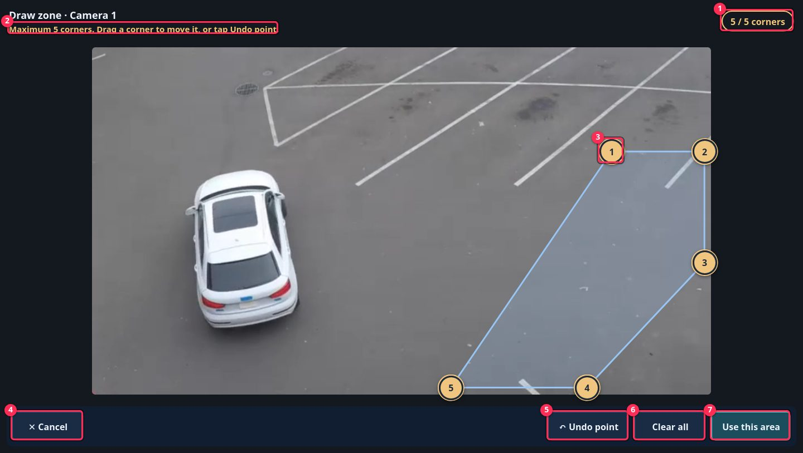

Full-screen frozen frame of the camera. Outline the ground where people or
vehicles walk; an object counts by where its feet touch the ground.

1. **Corners** — 3 to 5. Turns amber at 5.
2. **Next step** — what to do now. A sixth tap shows an amber warning.
3. **Corner** — tap the picture to add, drag to move. Each new corner gets
   the next number and joins the last corner to the first. Only if that
   would make the edges cross does it go into the nearest edge instead; the
   step line then says where it went and which corners were renumbered.
4. **Cancel** — leave without changes. Closing Rules also cancels.
5. **Undo point** — remove the corner tapped last.
6. **Clear all** — start again.
7. **Use this area** — enabled from 3 corners. If dragging makes the outline
   cross itself it turns red and this button waits until you fix it; then tap **Create alert** or **Save changes**.
   To remove a zone, tap **Remove area** in the alert form, then **Save changes**.

## Resources

1. **Tiles** — CPU, Memory, GPU engines, NPU and Package power. Click one to
   chart it.
2. **Chart** — last 5 minutes of the selected tile.
3. **Expand** — larger chart.
4. **Details** — raw readings.

## Voice questions and spoken answers

### Listening

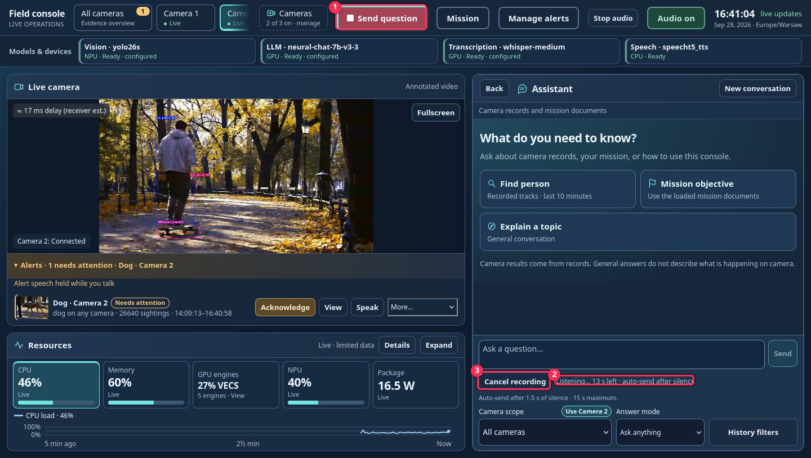

1. **Send question** — the Talk button while listening (red); tap to send.
2. **Status** — Listening, Transcribing, or what went wrong.
3. **Cancel** — discard the recording.

### Spoken answers

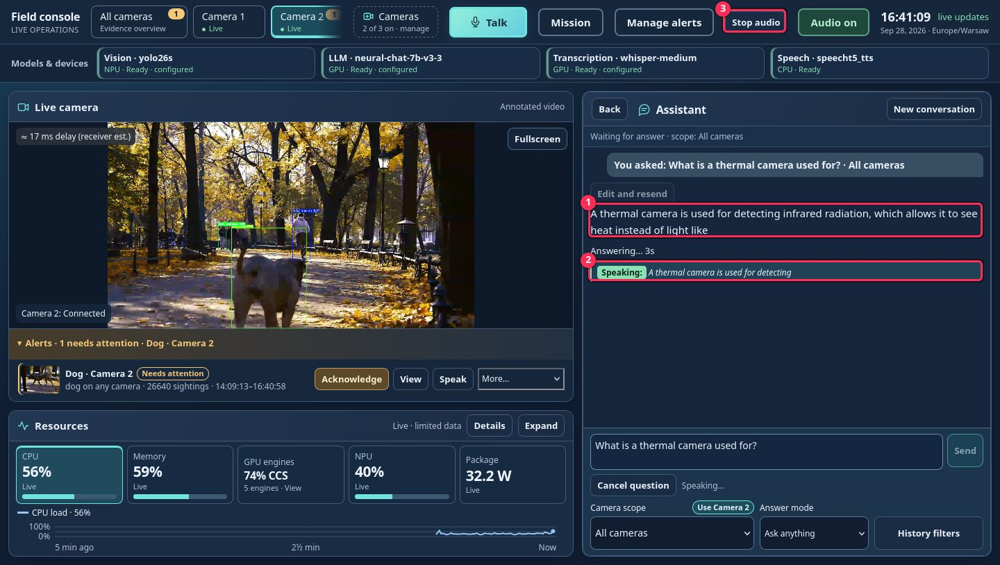

1. **Answer** — full text, always shown.
2. **Speech line** — what is being spoken now. A green **Speaking:** tag
   marks audio playing; an amber tag (**Preparing speech:**, **Starting
   speech:**) means it is not audible yet. The spoken sentence follows in
   italics. Text only if speech is unavailable.
3. **Audio on → off** — silences the rest of the answer; the text stays.

### How voice works

Tap **Talk** in the top bar from any console view. It opens Assistant and
starts recording after microphone permission is granted. Tap **Send question**
when finished; holding the button is not required.
Use trusted HTTPS. **Listening** means the browser microphone is active. Capture
ends when you tap Send question, after 15 seconds, or after a pause following speech. **Cancel**
or Escape discards the voice request, even while it is transcribing: you will not hear
"Checking." or an answer for it. Queued alert announcements are kept. The microphone
closes when capture ends.

**Transcribing** is followed by the recognized question and the normal answer
progress. Voice uses the same camera scope and answer mode as typing. If capture
or transcription fails, type your question; no camera settings are changed.

With **Audio on**, you hear "Checking." as soon as your question is recognized,
then the answer starts within a few seconds. Answers are spoken by the voice
**Miles**, in short parts (long sentences split into bounded clauses;
acronyms such as CPU and GPU are spelled out letter by letter). The first
part starts before the model has finished writing. Each part plays to its end,
then the next starts without a gap once ready. If several tabs or devices
have Audio on, each plays the answer at its own pace. Close extra tabs to hear
it once. The complete text stays visible. Turning **Audio off** cancels the
remaining speech without deleting the answer. Tapping Talk interrupts
playback immediately. Your answer is spoken first: alert announcements that
arrive while you ask or listen wait until the answer finishes, while the alert
itself appears on screen at once. Audio off, synthesis errors or browser playback restrictions
leave the text available. Tablet microphone and autoplay behavior still require
verification on the target browser.

### Recovering a question

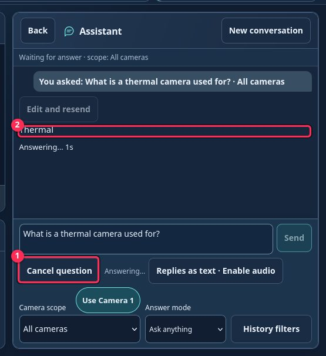

1. **Cancel question** — abandons the running question and stops its speech.
   The stock inference service may still finish its in-flight work, so the
   next answer can be slower. Finish or cancel a question before starting
   another with Talk.
2. **Streaming answer** — text appears as it is generated.

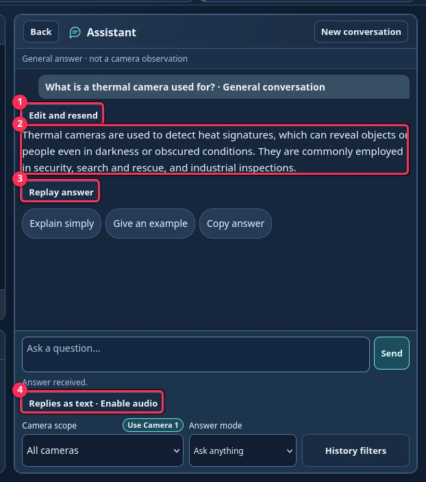

1. **Edit and resend** — puts the recognized question, with its original
   camera scope, back in the box for correction.
2. **Answer** — the complete text. An interrupted answer stays on screen
   marked incomplete, with **Retry question**.
3. **Replay answer** — reads the completed answer again (about the first
   1,500 characters) without asking the model again. Refused while an answer
   is still in progress.
4. **Replies as text · Enable audio** — shown when Audio is off; enable audio
   before Replay.

Turning **Audio off** silences speech while the text request keeps running. Failed
playback stays visible. While recording, a hint shows the 1.5-second silence
auto-send and 15-second limit.
