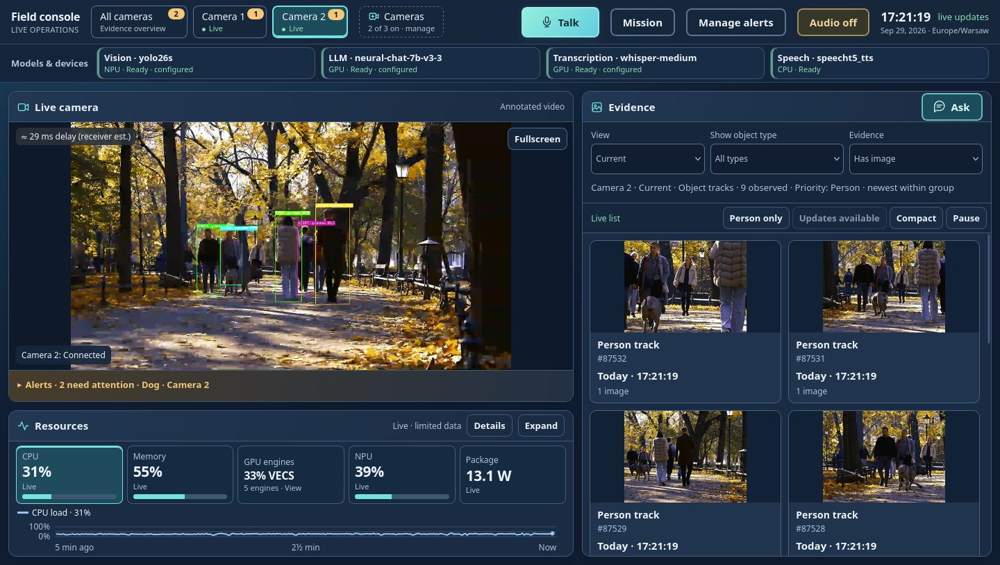
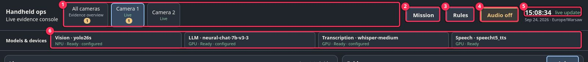
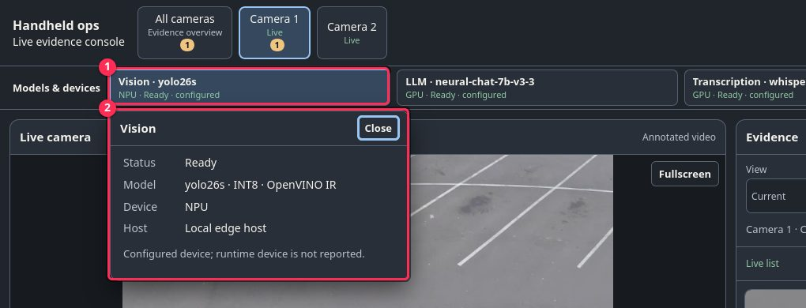
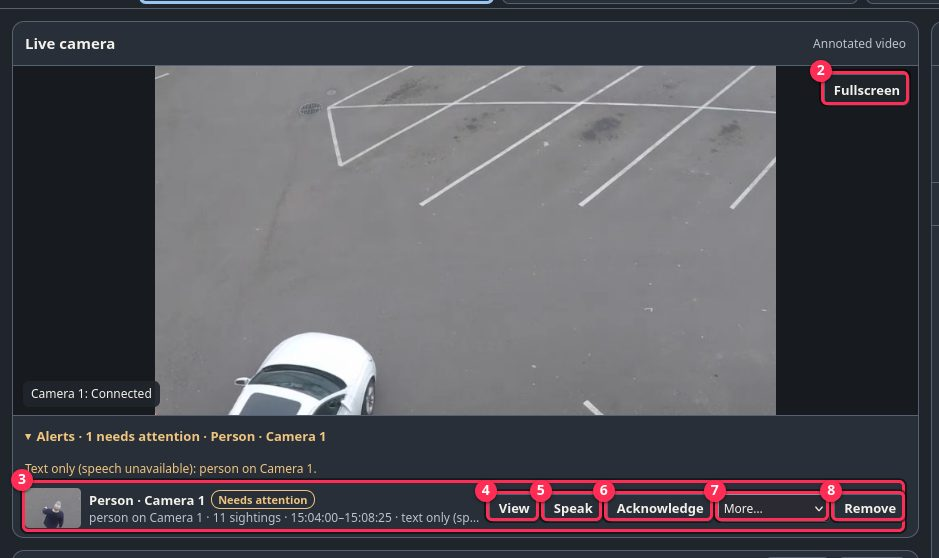
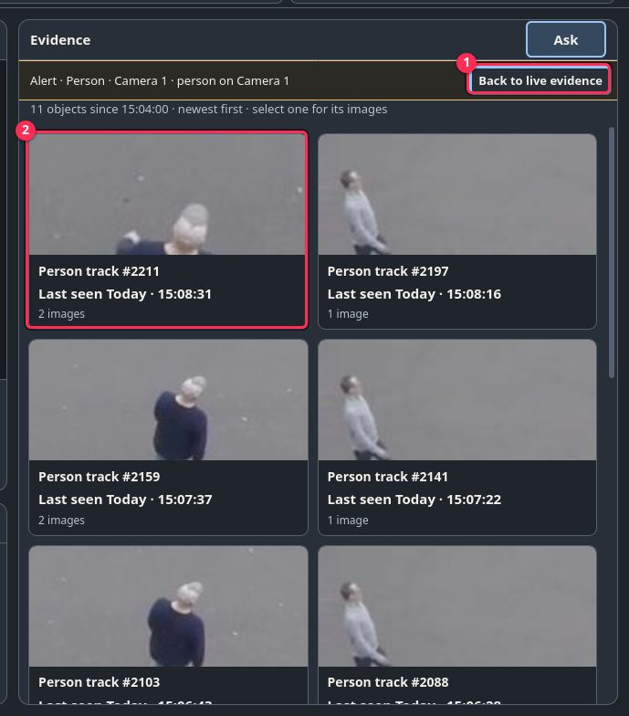
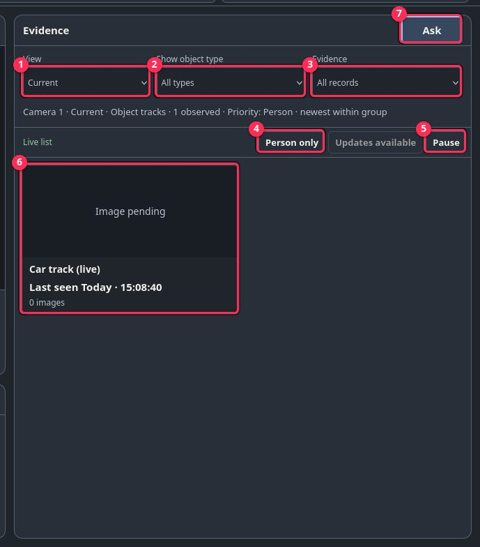
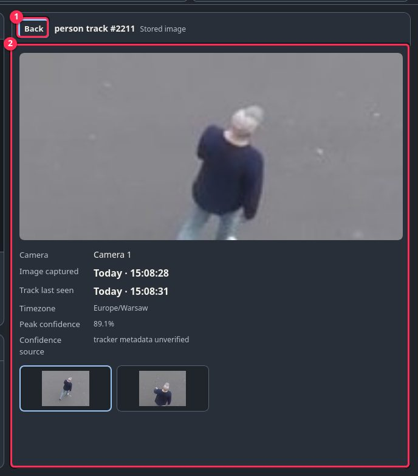
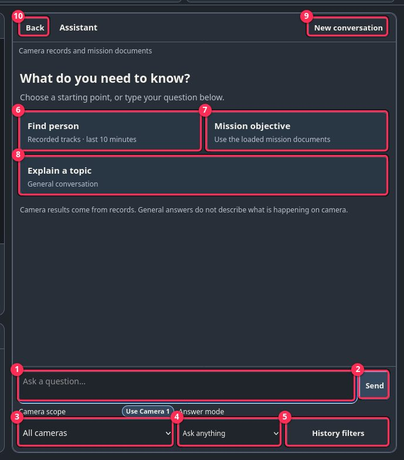
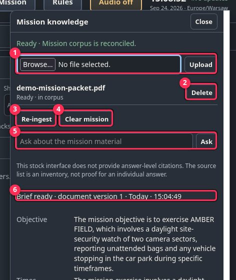
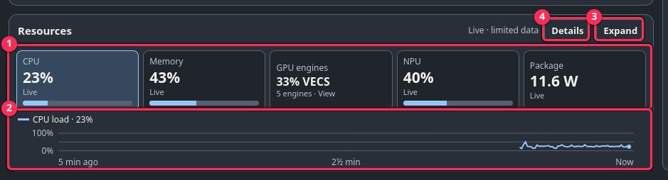

# Operator guide

Open `https://<device>:8443` and accept the self-signed certificate.
Red numbers in the pictures match the numbered lists below.

## Top bar

1. **Camera tabs** — pick the live camera. **All cameras** shows evidence
   from every camera. A yellow badge counts open alerts.
2. **Mission** — mission documents and brief (see [Mission](#mission)).
3. **Rules** — alert rules (see [Rules](#rules)).
4. **Audio off / Audio on** — tap once so the browser may play spoken
   alerts. Speech is silent until you do.
5. **Clock** — local time; "live updates" means the UI is connected.
6. **Models & devices** — each model with its device and status. Click one
   for details.

1. Clicked model (click again to close).
2. Status, model, device and host. **Close** hides it.

## Live camera and alerts

1. Annotated video of the selected camera (boxes on detected objects).
2. **Fullscreen** — enlarge the video.
3. **Alert** — object, camera, number of sightings, first–last time, state.
   The line above it shows what is being or was spoken.
4. **View** — show the objects that raised this alert in Evidence.
5. **Speak** — test: say the alert now (needs Audio on).
6. **Acknowledge** — "I've seen it". A new sighting reopens it.
7. **More…** — Snooze 5 / 15 min, Dismiss, False alarm, Retry delivery,
   Disable rule.
8. **Remove** — delete the alert from the list.

Speech labels: **spoken**, **not played (Audio off)**, **not spoken
(cooldown)**, **text only (speech unavailable)**.

After **View** the Evidence panel shows only that alert:

1. **Back to live evidence** — return to the normal list.
2. Each object that matched the alert; click for images.

## Evidence

1. **View** — **Current** (on screen now), **History · priority** or
   **History · newest** (recorded tracks).
2. **Show object type** — only persons, cars, …
3. **Evidence** — **All records** or **Has image**.
4. **Person only** — show only priority objects.
5. **Pause / Resume** — freeze the list; **Updates available** loads what
   arrived meanwhile.
6. **Object card** — click to open its images.
7. **Ask** — open the assistant.

1. **Back** — close the details.
2. Stored image, camera, times and confidence; thumbnails switch images.

## Ask (assistant)

1. Type a question.
2. **Send**.
3. **Camera scope** — which camera's records; **Use Camera N** picks the one
   on screen.
4. **Answer mode** — **Ask anything** (records, mission or general) or
   **General chat** (no camera records).
5. **History filters** — object type and time range.
6. **Find person** — recorded priority objects, last 10 minutes.
7. **Mission objective** — from the loaded mission.
8. **Explain a topic** — general conversation.
9. **New conversation** — forget earlier questions.
10. **Back** — close the assistant.

General chat remembers the last few exchanges; camera and mission answers do
not. General answers never describe what is on camera.

## Mission

1. **Browse… / Upload** — add a PDF or DOCX mission document.
2. **Delete** — remove that document.
3. **Re-ingest** — reload the documents and rebuild the brief.
4. **Clear mission** — remove all mission documents (camera history stays).
5. **Ask** — question about the mission documents only.
6. **Brief** — objective, times, locations, units, restrictions and
   resources extracted from the documents.

## Rules

1. **New rule** — object type, camera, minimum confidence, speech cooldown,
   and whether to announce by speech.
2. **Add rule**.
3. **Edit** — change a rule.
4. **Turn off / Turn on** — pause a rule without deleting it.
5. **Delete** — remove the rule.

A rule fires once per tracked object, not once per frame.

## Resources

1. **Tiles** — CPU, Memory, GPU engines, NPU and Package power. Click one to
   chart it.
2. **Chart** — last 5 minutes of the selected tile.
3. **Expand** — larger chart.
4. **Details** — raw readings.
