<!--
SPDX-FileCopyrightText: (C) 2026 Intel Corporation
SPDX-License-Identifier: Apache-2.0
-->

# Operator Guide

This guide describes how to use the operator console of the Handheld Multi-Modal application.
To open the console, follow the steps in
[Access Application User Interface](access-application.md). The red numbers in the screenshots
match the numbered lists below them.

The console shows the live camera and alerts on the left, the evidence and assistant on the
right, and resources at the bottom. Amber marks alerts that need your attention; red marks an
alerted object that is on camera now. On a handheld, run the browser in full screen (F11).

## Contents

- [Top Bar](#top-bar)
  - [Architecture Page](#architecture-page)
  - [Model Details](#model-details)
- [All Cameras](#all-cameras)
- [Adding and Removing Cameras](#adding-and-removing-cameras)
  - [Adding a Camera](#adding-a-camera)
  - [Network Camera](#network-camera)
  - [Publisher Camera Address](#publisher-camera-address)
  - [Editing and Removing a Camera](#editing-and-removing-a-camera)
- [Live Camera and Alerts](#live-camera-and-alerts)
  - [Viewing an Alert](#viewing-an-alert)
- [Evidence](#evidence)
  - [While You Were Away](#while-you-were-away)
  - [Evidence Details](#evidence-details)
- [Ask (Assistant)](#ask-assistant)
  - [How the Assistant Answers](#how-the-assistant-answers)
- [Mission](#mission)
- [Rules](#rules)
  - [Creating an Alert](#creating-an-alert)
  - [How Rules Match](#how-rules-match)
  - [Drawing a Zone](#drawing-a-zone)
- [Resources](#resources)
- [Voice Questions and Spoken Answers](#voice-questions-and-spoken-answers)
  - [Listening](#listening)
  - [Spoken Answers](#spoken-answers)
  - [Asking a Question by Voice](#asking-a-question-by-voice)
  - [Recovering a Question](#recovering-a-question)

## Top Bar

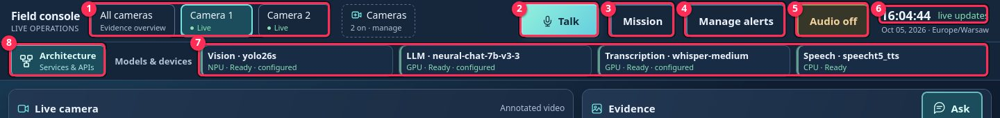

1. **Camera tabs** - select the live camera you want to watch. The console remembers the last
   camera you used. **All cameras** shows the live grid described in
   [All Cameras](#all-cameras). A badge on each tab counts the alerts that need attention. If
   you have many cameras, you can scroll the tabs sideways; a fade on the right means that more
   tabs are available.
2. **Talk** - ask a question by voice. While the console is listening, the button turns red and
   reads **Send question**. For details, see
   [Voice Questions and Spoken Answers](#voice-questions-and-spoken-answers).
3. **Mission** - open the mission documents and brief. See [Mission](#mission).
4. **Manage alerts** - create and edit alert rules. See [Rules](#rules).
5. **Audio off / Audio on** - the browser plays no speech until you tap this button. Amber
   means off and green means on. When you turn audio on, you hear the alerts that still need
   attention. Tap **Audio on** to turn audio off and stop any speech.
6. **Clock** - the local time. **live updates** means that the console is connected.
   **Connection lost · retrying** means that the data may be out of date until the console
   reconnects.
7. **Models & devices** - each model with the device it runs on and its status. By default,
   Vision runs on the NPU, the LLM (large language model) and Transcription run on the GPU,
   and Speech runs on the CPU. Tap a model to see its details.
8. **Architecture** - open the architecture page. Tap **Back to app** to return to the
   console.

### Architecture Page

The architecture page shows every service of the application and how data moves between them.
Each box shows whether the service is an **Intel® Open Edge Platform** microservice, **Open
source** infrastructure, or the custom **Application** Backend, and its dot shows live status.
Tap a service to highlight its connections and see its role, APIs, model and device; tap it
again or press Escape to return to the full view. Tap **Follow a flow** to step through a path,
such as a voice question. Below the diagram, you can see **Where each model runs** and the
**Open Edge Platform APIs used**. Tap **Back to app** to return to the console.

### Model Details

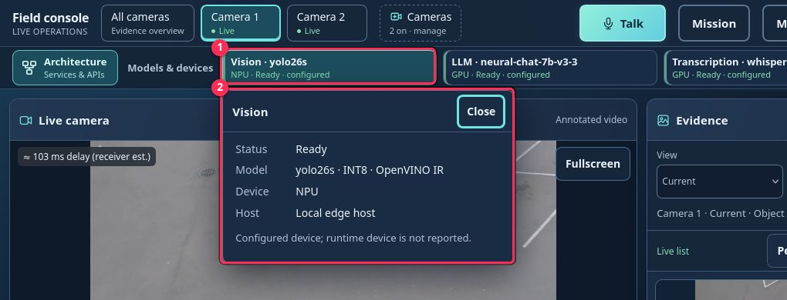

1. The model you selected. Tap it again to close the details.
2. The status, model, device and host. Tap **Close** to hide the details. **Starting** means
   that the service is still loading or downloading its model. The first start can take up to
   an hour. If you ask a question during this time, the assistant tells you that the model is
   not ready yet, so try again later.

## All Cameras

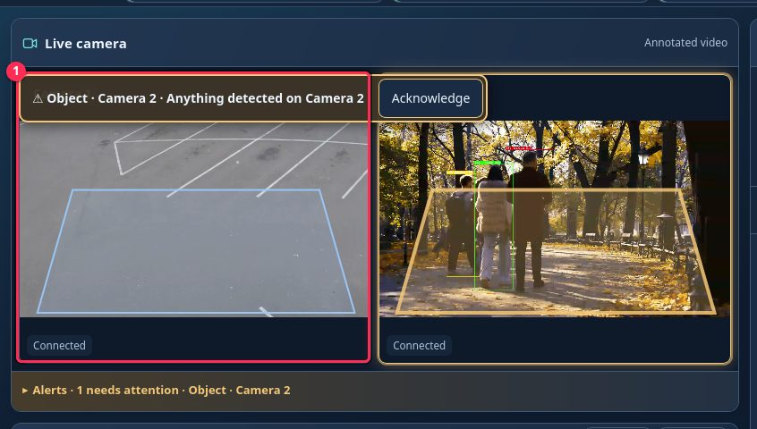

1. **Tile** - one camera, with up to four cameras per page. Tap a tile to open that camera. A
   tile with open alerts pulses red while the alerted object is on camera, and turns steady
   amber after the object has left. Alert areas are drawn on each tile in the same colors.
2. **‹ / ›** - show the next or previous four cameras. These buttons appear only when you have
   more than four cameras.

## Adding and Removing Cameras

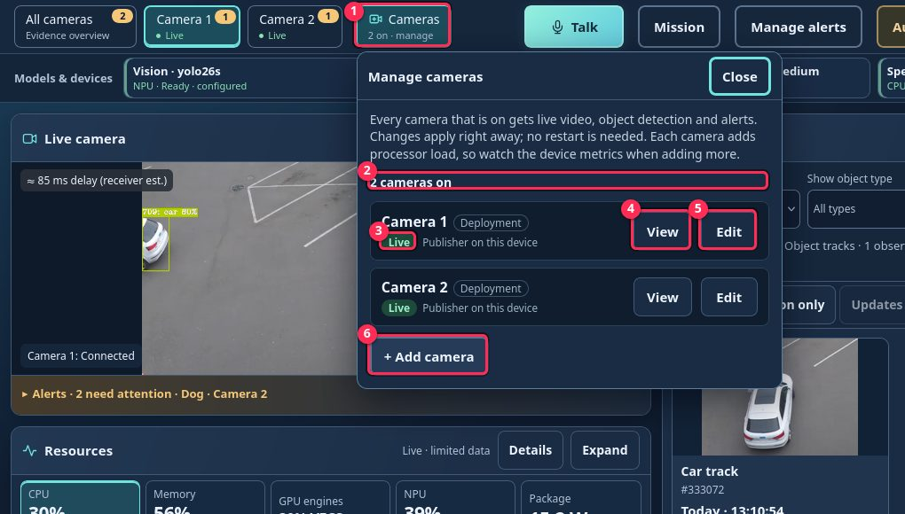

1. **Cameras** - in the top bar, next to the camera tabs, this button shows how many cameras
   are on (for example, "2 on"). Tap it to open **Manage cameras**.
2. **Count** - the number of cameras that are on (for example, "2 cameras on").
3. **State** - one of **Live**, **Starting**, **No frames received**, **Signal lost** or
   **Off**. **Deployment** marks cameras that were configured during deployment.
4. **View** - show the video of that camera and close the panel.
5. **Edit** - rename, turn off or remove the camera.
6. **+ Add camera** - open the form for adding a camera. There is no fixed limit on the number
   of cameras, but each active camera adds processor load, so check the
   [Resources](#resources) after adding one.

### Adding a Camera

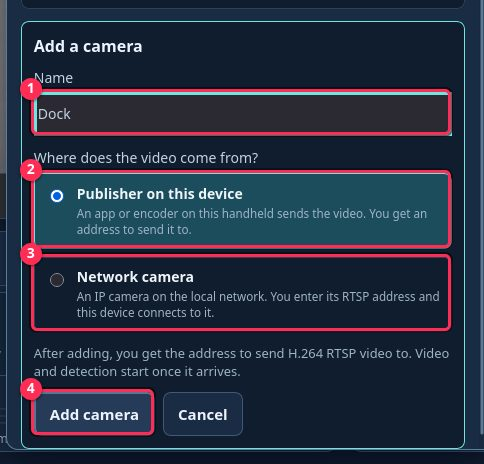

1. **Name** - the name shown in the camera tabs, alerts and evidence.
2. **Publisher on this device** - choose this option if an app or encoder on this handheld
   sends the video. You receive the address to send it to after you add the camera.
3. **Network camera** - choose this option for an IP camera on the local network.
4. **Add camera** - add the camera, or tap **Cancel** to close the form.

### Network Camera

For a network camera, enter its address:

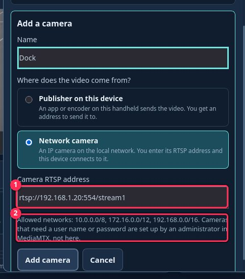

1. **Camera RTSP address** - the `rtsp://` address of the camera.
2. **Note** - the networks that are allowed. The console refuses addresses outside these
   networks and addresses that contain a user name or password. Ask your administrator to set
   up such cameras.

### Publisher Camera Address

After you add a **publisher** camera, the panel shows where to send its video:

1. **Waiting for video** - no video has arrived yet.
2. **Address** - send H.264 RTSP video to this address, for example
   `rtsp://127.0.0.1:8554/cam4`. The address works only on this device.
3. **Copy** - copy the address so that you can paste it into the publisher app.
4. **Example** - a ready-to-use ffmpeg command that sends a video file to the address.
5. **View camera** - available after the video arrives.

The card updates automatically when the video arrives:

1. **Live** - the video, detection and alerts are running.
2. **View camera** - switch to the camera. Tap **Done** to close the card.

You can also find the address under **Edit** at any time.

### Editing and Removing a Camera

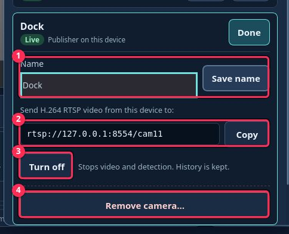

1. **Name** and **Save name** - rename the camera.
2. **Address** and **Copy** - the address to send the video to (publisher cameras only).
3. **Turn off / Turn on** - stop or restart the video and detection for the camera.
4. **Remove camera…** - remove the camera. The console asks you to confirm:

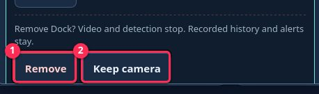

1. **Remove** - remove the camera.
2. **Keep camera** - cancel and keep the camera.

Turning off or removing a camera keeps its history and alerts. You can only rename
**Deployment** cameras here. Alert rules for a camera that is off or removed show
**(camera off or removed)**; you can turn them off or delete them, but not turn them back on.
Changes take effect without a restart.

## Live Camera and Alerts

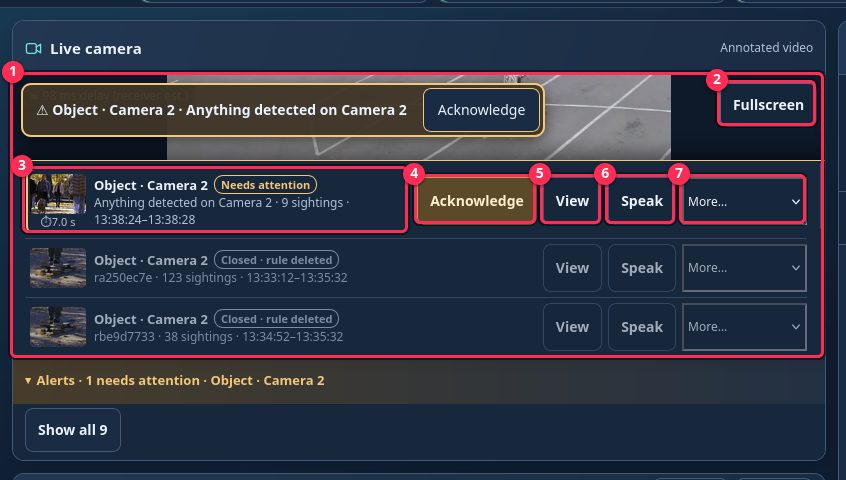

When a new alert is raised, the camera badges and highlights update, and a banner appears at
the top of the video (for example, "Person in Gate area · Camera 2"). The banner stays until you
tap **View** or **Acknowledge**, or until the alert closes. If several alerts arrive, they are
stacked as "+N more". An alert that needs attention is shown in one of two ways:

- **In view now** - the alerted object is on camera at this moment (and inside the alert area,
  if the alert has one). The banner starts with a red dot, the video border and the alert area
  pulse red, and the camera badge turns red.
- **Needs attention** - the object has left, but nobody has acknowledged the alert yet. The
  alert is shown in steady amber, and the banner says when the object was last seen.

After you acknowledge an alert, it is shown in neither color. Tap the **Alerts** bar under the
video to open or close the list of alerts.

1. The annotated video of the selected camera, with boxes around the detected objects. The small
   badge shows the estimated video delay, when available.
2. **Fullscreen** - enlarge the video.
3. **Alert** - the object, camera, number of sightings, first and last time, and state
   (**In view now**, **Needs attention**, **Acknowledged** and so on). Tap the picture or text
   to see the objects that raised the alert in Evidence. The ⏱ time under the picture shows how
   many seconds passed between the first detection and the alert reaching you. Hover over it or
   long-press it to see each step.
4. **Acknowledge** - confirm that you have seen the alert. A new sighting reopens the alert.
5. **View** - the same as tapping the alert.
6. **Speak** - read the alert aloud now, after a short chime. Audio must be on.
7. **More…** - **Snooze** for 5 or 15 minutes, **Dismiss**, **False alarm**,
   **Retry delivery**, **Disable rule**, or **Remove from list** (asks you to confirm).

Each alert also shows whether it was spoken: **spoken**, **not played (Audio off)**,
**not spoken (cooldown)** or **text only (speech unavailable)**.

### Viewing an Alert

After you tap **View**, the Evidence panel shows only that alert:

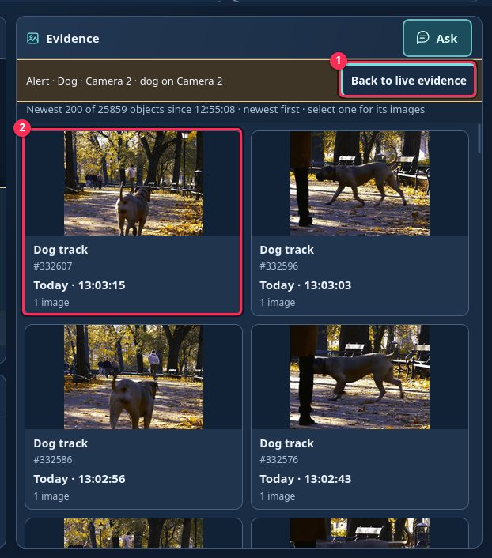

1. **Back to live evidence** - return to the normal list.
2. Each object that matched the alert. Tap one to see its images.

## Evidence

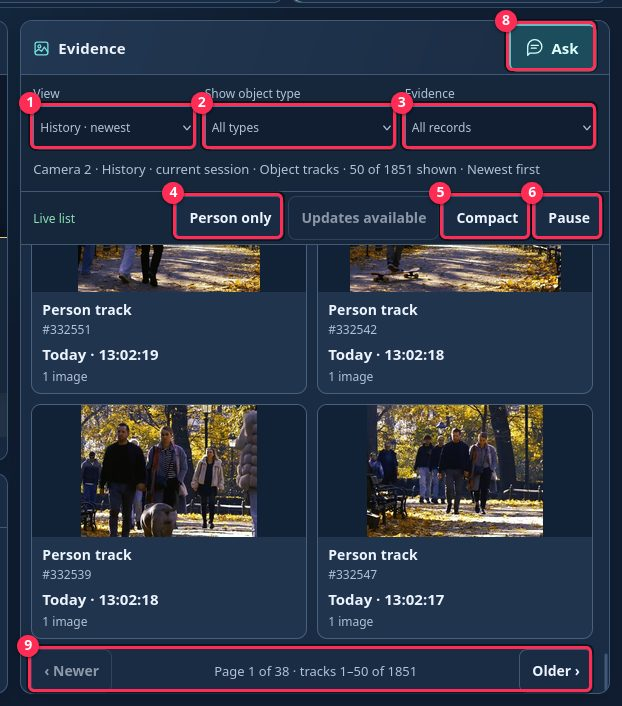

1. **View** - choose **Current** (objects on screen now), **History · priority** or
   **History · newest** (recorded objects).
2. **Show object type** - show only one type of object, such as persons or cars.
3. **Evidence** - show **All records** or only records that **Has image**.
4. **Person only** - show only priority objects.
5. **Compact / Cards** - switch between dense rows and image cards. The console remembers your
   choice.
6. **Pause / Resume** - freeze the list. Tap **Updates available** to load what arrived in the
   meantime.
7. **Object card / row** - tap to open the images of the object.
8. **Ask** - open the assistant.
9. **‹ Newer / Older ›** - page through the history, 50 objects per page. Only the first page
   updates live. Changing the camera, view or filters returns you to the first page.

### While You Were Away

If you return after five or more minutes away, a **While you were away** card summarizes the new
alerts and objects. Tap **View** to see them.

### Evidence Details

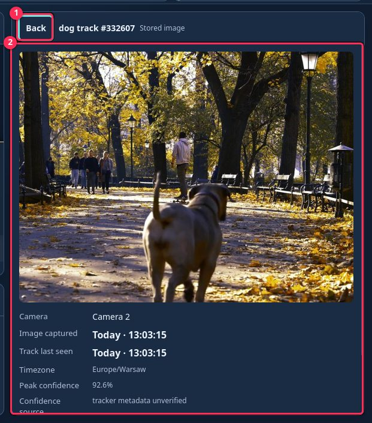

1. **Back** - close the details.
2. The full stored image, followed by the camera, times and confidence. Tap the image to view
   it in full screen, and tap the thumbnails to switch between images.

## Ask (Assistant)

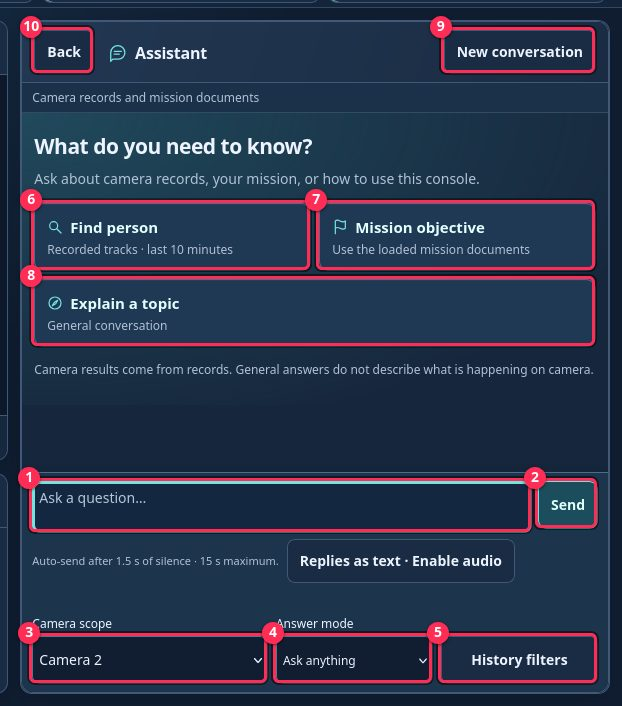

1. Type your question.
2. Tap **Send**.
3. **Camera scope** - the camera whose records the assistant searches. By default, it follows
   the camera on screen, or **All cameras** in the grid. You can pick another camera until you
   switch cameras again.
4. **Answer mode** - **Ask anything** (camera records, mission or general questions) or
   **General chat** (no camera records).
5. **History filters** - limit the search by object type and time range.
6. **Find person** - list the recorded priority objects from the last 10 minutes. The button
   is named after the configured priority object type and is hidden when none is set.
7. **Mission objective** - ask about the objective of the loaded mission.
8. **Explain a topic** - start a general conversation.
9. **New conversation** - make the assistant forget earlier questions.
10. **Back** - close the assistant.

### How the Assistant Answers

The assistant never asks you to rephrase a question. It answers with its closest match and
first tells you what it assumed:

- If you do not give a time, it searches the **last 10 minutes** and says so.
- A camera named in your question takes priority over **Camera scope**.
- The application does not detect details such as color, brand or license plates. If you ask
  about them (for example, "What color is the bicycle?"), the assistant says so and shows the
  matching objects so that you can check their images.
- You can ask short follow-up questions about the mission, such as "Who receives it?". Tap
  **New conversation**, change the mission documents, or stay idle for ten minutes to start
  over.
- General chat remembers the last few exchanges; answers about camera records do not. General
  answers never describe what is on camera.

You can also ask how the application works, for example "What runs on the NPU?" or "How does
video reach my screen?". The assistant answers from a built-in description of the application.
You can check the details on the **Architecture** page and in **Models & devices**.

## Mission

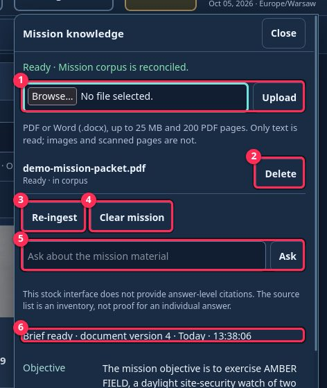

1. **Browse… / Upload** - add a PDF or Word (.docx) mission document, by default up to 25 MB
   and 200 PDF pages. Only text is read; images and scanned pages are ignored.
2. **Delete** - remove the document.
3. **Re-ingest** - reload the documents and rebuild the brief.
4. **Clear mission** - remove all mission documents. The camera history is kept.
5. **Ask** - ask a question about the mission documents only.
6. **Brief** - the objective, times, locations, units, restrictions and resources taken from the
   documents.

## Rules

### Creating an Alert

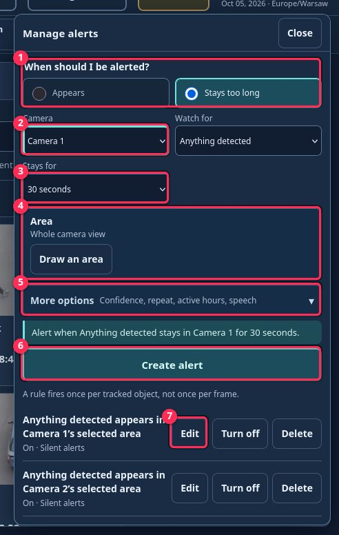

1. Open **Manage alerts** and choose **Appears** or **Stays too long**.
2. Check the **Camera** (by default, the camera you are viewing) and **Watch for**.
   **Anything detected** includes every object type that the application detects.
3. **Stays for** (only for **Stays too long**) - choose 10 seconds, 30 seconds, 1 minute or a
   custom duration.
4. **Area** - by default, the whole camera view. Choose **Draw an area** to limit the alert to
   part of the view of any camera.
5. **More options** - set confidence, repeat, active hours and speech. **Announce again after**
   (5 to 3600 seconds) sets how long to wait before announcing new objects for an open alert.
6. Read the plain-language preview, then tap **Create alert**.
7. Existing alerts show their conditions, with **Edit**, **Turn off / Turn on** and **Delete**
   beside each. Tap **Save changes** to finish editing.

### How Rules Match

An alert fires once for each tracked object, not for each video frame. For **Stays too long**,
each object has its own timer, which restarts if the object is not seen for a while or if you
change or re-enable the alert. To monitor the whole view again, tap **Remove area** and save.

### Drawing a Zone

The console shows a full-screen still image from the camera. Outline the ground where people or
vehicles move, because an object counts by where its feet or wheels touch the ground.

1. **Corners** - you can use 3 to 5 corners. The counter turns amber at 5.
2. **Next step** - tells you what to do next. If you tap a sixth time, an amber warning
   appears.
3. **Corner** - tap the picture to add a corner, and drag a corner to move it. If a new corner
   would make the edges cross, it is placed on the nearest edge instead, and the step line tells
   you which corners were renumbered.
4. **Cancel** - leave without changes. Closing **Manage alerts** also cancels.
5. **Undo point** - remove the last corner you added.
6. **Clear all** - start again.
7. **Use this area** - available from 3 corners. If the outline crosses itself, it turns red,
   and you must fix it before you can use it. Then tap **Create alert** or **Save changes**.
   To remove a zone, tap **Remove area** in the alert form and then **Save changes**.

## Resources

1. **Tiles** - CPU, Memory (free RAM), GPU engines, NPU, Package power and Services. Tap a tile
   to show its chart.
2. **Chart** - the last 5 minutes of the selected tile. For **Services**, you see one card per
   application service instead, with its share of CPU and memory use, busiest first. Tap
   **+N more · Expand** to see all of them.
3. **Expand** - show a larger chart.
4. **Details** - show the raw readings.

## Voice Questions and Spoken Answers

### Listening

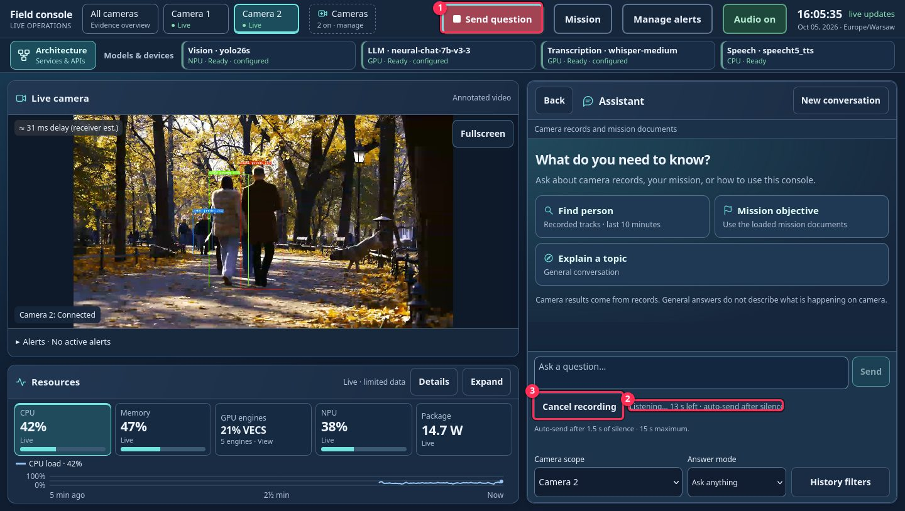

1. **Send question** - the red Talk button while the console is listening. Tap it to send your
   question.
2. **Status** - **Listening**, **Transcribing**, or a description of what went wrong.
3. **Cancel** - discard the recording.

### Spoken Answers

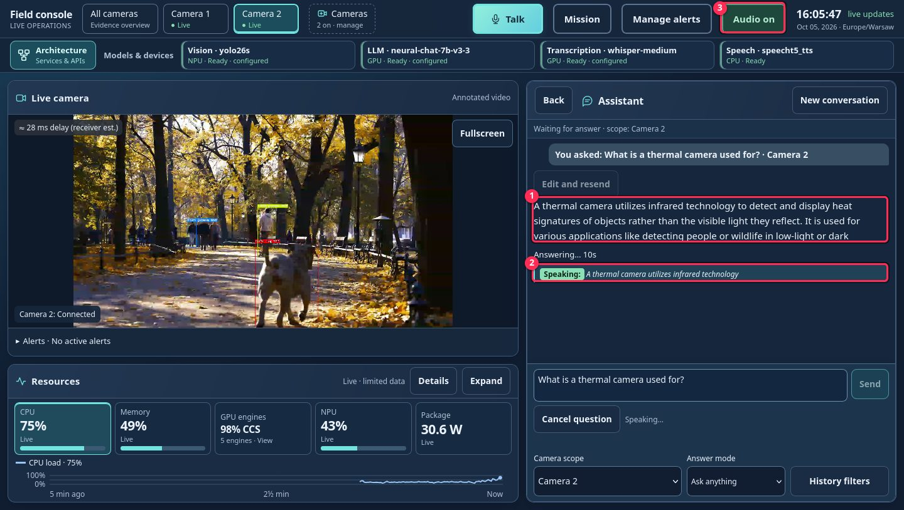

1. **Answer** - the full text of the answer, which is always shown.
2. **Speech line** - the sentence being spoken now, in italics. A green **Speaking:** tag means
   that audio is playing. An amber tag (**Preparing speech:** or **Starting speech:**) means
   that it is not audible yet. If speech is unavailable, only the text is shown.
3. **Audio on → off** - stop the rest of the spoken answer. The text stays on screen.

### Asking a Question by Voice

1) Tap **Talk** in the top bar from any view. The assistant opens and starts recording after
   you allow the browser to use the microphone. The console must be opened over trusted HTTPS.
2) Ask your question. You do not need to hold the button. Recording stops when you tap
   **Send question**, after a 1.5-second pause, or after 15 seconds.
3) The status changes to **Transcribing**, and then your recognized question and the answer
   appear. Voice questions use the same camera scope and answer mode as typed questions.

To discard a voice question, tap **Cancel** or press Escape. If recording or transcription
fails, type your question instead. With **Audio on**, you hear "Checking." when your question is
recognized, and the spoken answer starts within a few seconds. Alert announcements wait until
the answer finishes, but alerts appear on screen at once. If several tabs or devices have audio
on, each plays the answer, so close extra tabs to hear it once.

### Recovering a Question

1. **Cancel question** - stop the running question and its speech. The next answer may be
   slower while the model finishes its previous work, so finish or cancel one question before
   you ask another with **Talk**.
2. **Streaming answer** - the text appears as it is generated.

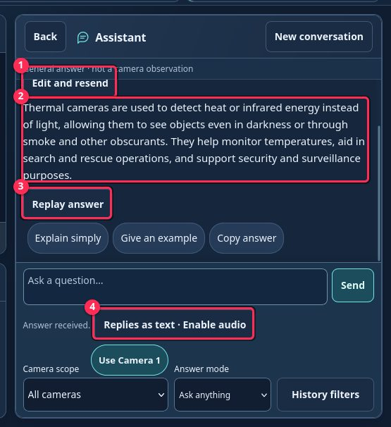

1. **Edit and resend** - put the recognized question, with its original camera scope, back in
   the text box so that you can correct it.
2. **Answer** - the complete text. If an answer is interrupted, it stays on screen marked as
   incomplete, with a **Retry question** button.
3. **Replay answer** - read the completed answer aloud again (about the first 1,500 characters)
   without asking the model again. You cannot replay an answer that is still in progress.
4. **Replies as text · Enable audio** - shown when audio is off. Enable audio before you tap
   **Replay answer**.
