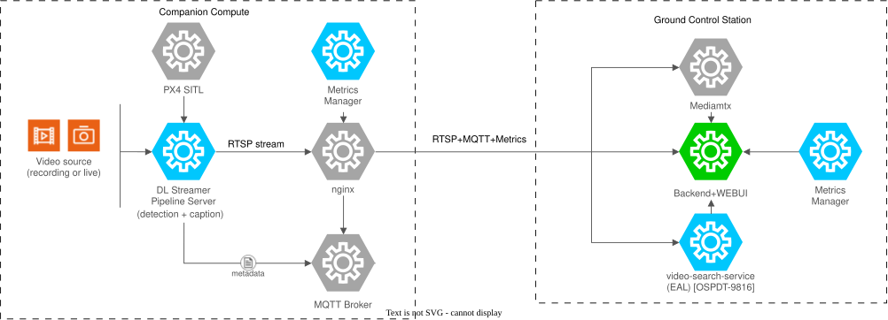

<!--
SPDX-FileCopyrightText: (C) 2026 Intel Corporation
SPDX-License-Identifier: Apache-2.0
-->
# UAV Vision Analytics Application

The UAV Vision Analytics application is an AI-powered UAV object detection application with live telemetry overlay, optimized for Intel® edge hardware. It processes video from a UAV-mounted camera (or a simulated video file), runs YOLO11s inference across 80 object classes, and overlays correlated MAVLink telemetry (GPS, altitude, speed, heading) on the output RTSP stream. The stream is consumable by any capable client, such as QGroundControl (QGC), VLC, and ffplay.

The application is built on Intel DL Streamer Pipeline Server and supports two deployment modes: a self-contained **Standalone (pymavlink)** mode using Gazebo/PX4 Software-in-the-Loop (SITL) simulation, and a **UAV Mission Compute SDK** mode that integrates with a running instance of the UAV Mission Compute SDK for full mission control and multi-camera pipeline management. Both modes are deployed on top of the Edge Node Infrastructure software - an edge computing platform, which enables hardware acceleration capabilities. See [Infrastructure Setup](docs/user-guide/infrastructure-setup.md) for build and provisioning steps.



## Project Structure

```text
docker-compose-pymavlink.yml  Standalone mode: PX4 SITL, mavlink-router, broker, DL Streamer Pipeline Server, metrics-manager, nginx.
docker-compose-uavsdk.yml     UAV Mission Compute SDK mode: DL Streamer Pipeline Server + nginx (connects to an external SDK stack).
.env.example                  Template for .env — HOST_IP, GPU/NPU/camera device paths, and image tags.
Makefile                      Operational targets (init, model, vlm-model, pymav-*, uavsdk-*, start-rtsp, check-cameras, cameras-status).
configs/                      Camera files (`cameras-*.yaml`), DL Streamer Pipeline Server pipeline configs, Mosquitto, mavlink-router and nginx configuration.
gvapython/                    Telemetry overlay Python scripts (pymavlink and UAVSDK variants).
scripts/                      Pipeline manager, camera configuration validator, MAVLink listener, video converter.
docs/                         User guide.
resources/                    Python requirements for `make model`, sample input video, the exported YOLO11s model (after running `make model`), and the VLM model under `ov_models/` (after running `make vlm-model`).
benchmark/                    Stream density benchmarking tooling (`calc_stream_density.sh`).
```

> `make vlm-model` fetches `download_models.sh` on demand (pinned to a commit, cached
> under `.cache/`) from its canonical copy in
> `metro-ai-suite/live-video-analysis/live-video-captioning/model_download_scripts/`
> rather than vendoring a duplicate here — see the Make Targets section below.

## Stack

Container names use the prefix `uav-va-` (vision analytics), for example `uav-va-dlstreamer-pipeline-server` for the DL Streamer Pipeline Server. The ground station uses `uav-gs-`. The compose service names listed below are unchanged.

### Standalone Mode (pymavlink)

| Service | Image | Role |
|---------|-------|------|
| `broker` | `eclipse-mosquitto:2.0.22` | MQTT broker for telemetry and pipeline events |
| `px4` | `px4io/px4-sitl:latest` | PX4 SITL flight controller simulation |
| `mavlink-router` | Built from `uav-mission-compute-sdk/infra/px4-sim/mavlink-router` | Routes MAVLink telemetry between PX4 and the pipeline server; publishes UDP `14551` for a remote QGroundControl |
| `dlstreamer-pipeline-server` | `intel/dlstreamer-pipeline-server:2026.3.0-ubuntu24-rc1` (+ `pymavlink`) | Core inference engine — YOLO11s detection and telemetry overlay |
| `metrics-manager` | `intel/metrics-manager:2026.3.0-rc1` | Host platform (CPU/GPU) metrics |
| `nginx` | `nginx:1.27-alpine` | Reverse proxy for HTTPS, RTSP and MQTT |

All services share the `app_network` Docker network and are defined in [`docker-compose-pymavlink.yml`](docker-compose-pymavlink.yml). Only `nginx` (HTTPS, RTSP, MQTT) and `mavlink-router` (MAVLink UDP `14551`, for a remote QGroundControl) publish ports to the host; `dlstreamer-pipeline-server` and `metrics-manager` are reachable exclusively through `nginx`.

### UAV Mission Compute SDK Mode

| Service | Image | Role |
|---------|-------|------|
| `dlstreamer-pipeline-server` | `intel/dlstreamer-pipeline-server:2026.3.0-ubuntu24-rc1` | Core inference engine — YOLO11s detection and telemetry overlay; connects to an externally running UAV Mission Compute SDK stack |
| `nginx` | `nginx:1.27-alpine` | Reverse proxy — the only service that publishes ports to the host |

Defined in [`docker-compose-uavsdk.yml`](docker-compose-uavsdk.yml). Requires the
`federal-and-aerospace-ai-suite/uav-mission-compute-sdk` stack to be running first. Only `nginx` publishes ports to the host; `dlstreamer-pipeline-server` is reachable exclusively through it.

## Prerequisites

| Requirement | Notes |
|-------------|-------|
| Docker Engine release 24 or later | [Install guide](https://docs.docker.com/engine/install/) |
| Docker Compose v2 | Included with Docker Desktop; on Linux OS, install the `docker-compose-plugin` package. Use `docker compose` (space), not `docker-compose` (hyphen). |
| Intel® GPU with OpenVINO support | Required for `GPU_DEVICE` / `GPU_RENDER_DEVICE` in `.env`. |
| Python 3 with `venv` | Required by `make model` to create a Python virtual environment for exporting YOLO11s. |
| Intel® NPU (optional) | For NPU-accelerated pipelines; falls back to `/dev/null` (disabled) if not detected. |
| USB or RealSense camera (optional) | For live-camera pipelines; auto-detected by `make init`. |

Run `make init` after cloning to create `.env` from `.env.example`, auto-detect the host IP (`HOST_IP`), and auto-detect GPU, NPU, and camera device paths. No manual `.env` edit is needed.

## Quick Start

Run the commands from the `uav-vision-analytics` directory (`cd federal-and-aerospace-ai-suite/uav-vision-analytics` after `git clone https://github.com/open-edge-platform/federal-and-aerospace-ai-suite.git`, or the directory of the downloaded ZIP; see [Get Started](docs/user-guide/get-started/get-started-standalone.md)).

### Step 1: Initialize and download the models

```bash
make init
make model
make vlm-model
```

`make model` creates a Python virtual environment, downloads YOLO11s, and exports it to OpenVINO FP16 format under `resources/models/yolo11s/`.

`make vlm-model` downloads/converts `OpenGVLab/InternVL2-1B` (override with `VLM_MODEL_ID=...`) to OpenVINO IR for `CPU` and `GPU` (override with `VLM_DEVICE=gpu`, etc.; the VLM does not run on the NPU) under `resources/ov_models/<device>/`. The shipped `configs/cameras-pymavlink.yaml` turns captions on for two cameras, so it is needed for the default setup; skip it only if you switch captioning off for every camera.
### Step 2: Start a deployment mode

**Standalone Mode (pymavlink)** — self-contained, no external dependencies:

```bash
make pymav-up
```

**UAV Mission Compute SDK Mode** — requires the UAV Mission Compute SDK stack running first:

```bash
make uavsdk-up
```

### Step 3: Start the cameras

```bash
make check-cameras   # validate configs/cameras-pymavlink.yaml and show what would run (nothing is started)
make start-rtsp      # start the cameras when the vehicle is armed
```

The cameras come from [`configs/cameras-pymavlink.yaml`](configs/cameras-pymavlink.yaml): for each one the video, the device and model that
detect objects, whether a VLM writes scene captions (device, model, prompt) and whether detections are drawn on the stream.
The shipped file has three cameras (`front_camera`, `bottom_camera`, `back_camera`), detection on the NPU and captions from
the VLM on the GPU, so arming the vehicle is all that is needed. After editing the file, `make check-cameras` validates
it, `make start-rtsp` (or disarm and arm again) applies it, and `make cameras-status` compares the file with what is
running. See [Configure the Cameras](docs/user-guide/how-to-customize/camera-management/configure-cameras.md).

Streams are published as `rtsp://<HOST_IP>:8555/uav-<camera>` (for example `uav-front-camera`) and the captions of a
camera on MQTT `uav/caption/<camera>`. Captions need the VLM model (`make vlm-model`, Step 1).

### Using your own videos

The cameras play looping `.avi` files from `resources/videos/` (`uav_sample_front.avi`,
`uav_sample_bottom.avi`, `uav_sample_back.avi` in the shipped `configs/cameras-pymavlink.yaml`). To use your own footage
in any format ffmpeg can read (`.mp4`, `.mov`, `.mkv`, `.avi`, `.ts`, ...), convert it with:

```bash
./scripts/convert_video.sh my_clip.mp4 -o resources/videos/my_clip.avi -f   # then set 'video: my_clip.avi' for a camera
```

The script writes H.264 (High, yuv420p), 30 fps, no audio, ~4 Mbps, with a keyframe every 250 frames, trimmed to
whole GOPs so the loop point is clean, and verifies the result. If you have several cameras, pass the same
`--frames N` to every file so their loops have the same length and stay in step (for example `-n 1750`).
Other options: `--bitrate`, `--fps`, `--size WxH`, `--gop`, `--no-trim`; run it with `--help`.
It uses `ffmpeg` from the host if installed, otherwise the DL Streamer image from `.env`, so only Docker is
required. Restart the cameras (`make start-rtsp`) after replacing a file. See
[Use Your Own Videos](docs/user-guide/how-to-customize/model-and-video-management/use-your-own-video.md) for the full steps.

### Starting pipelines without arming the drone

`make start-rtsp` waits for the vehicle to be armed. To run the cameras of `configs/cameras-pymavlink.yaml` right away, without
a vehicle (Ctrl+C stops them):

```bash
docker exec -it -e HOST_IP=<HOST_IP> uav-va-dlstreamer-pipeline-server \
  python3 /home/pipeline-server/scripts/pipeline_manager.py --start-now
```

For a single ad-hoc pipeline, use the REST API (see [Manage Pipelines](docs/user-guide/how-to-customize/pipeline-management/manage-pipelines.md#rest-api)).
The RTSP output is H.264 encoded, which is what the `uav-ground-station` relay expects.

## Endpoints

All HTTP(S) traffic is served through the nginx reverse proxy on port 443 (HTTPS,
self-signed cert; plain HTTP on port 80 redirects to HTTPS. `dlstreamer-pipeline-server`
and `metrics-manager` no longer publish ports directly to the host.

| Service | URL / Path | Notes |
|---------|-----------|-------|
| DL Streamer Pipeline Server REST API | `https://<HOST_IP>/` | Pipeline control and status, proxied to `dlstreamer-pipeline-server:8081` |
| RTSP annotated streams | `rtsp://<HOST_IP>:8555/uav-<camera>` | One stream per camera of `configs/cameras-pymavlink.yaml`: detection + telemetry overlay output (H.264; the overlay can be switched off per camera); TCP passthrough via nginx `stream {}` |
| MQTT scene captions (cameras with captioning on) | `mqtt://<HOST_IP>:1883`, topic `uav/caption/<camera>` | VLM-generated natural-language scene description from the raw (non-overlaid) video; one topic per camera; TCP passthrough via nginx `stream {}` to the `broker` container (e.g. `mosquitto_sub -h <HOST_IP> -t uav/caption/<camera> -v`) |
| Metrics manager SSE stream (Standalone mode only) | `https://<HOST_IP>/metrics/stream` | Host platform (CPU/GPU) metrics, proxied to `metrics-manager:9090` |
| Metrics manager REST snapshot (Standalone mode only) | `https://<HOST_IP>/api/v1/metrics/latest` | Host platform (CPU/GPU) metrics, proxied to `metrics-manager:9090` |

`<HOST_IP>` is auto-detected and written to `.env` by `make init` (defaults to `localhost`/`127.0.0.1` when run locally). The self-signed TLS certificate is generated automatically into `configs/nginx/ssl/` the first time `make pymav-up`/`make uavsdk-up` runs — use `curl -k` to skip verification.

> [!IMPORTANT]
> `nginx`'s ports (`80`, `443`, `8555`, `1883`) are published on `HOST_IP`, so they are
> reachable from your LAN by default (needed for QGroundControl/VLC/ffplay on other
> devices, and for subscribing to MQTT captions remotely) — not just `localhost`. RTSP
> and MQTT traffic are both unencrypted, and neither the REST API, the RTSP stream, nor
> the MQTT broker is authenticated. Set `HOST_IP=127.0.0.1` in `.env` to restrict access
> to the local host only.

## Make Targets

```text
make init          Create .env from template, auto-detect HOST_IP, and auto-detect GPU/NPU/camera device paths
make model         Download YOLO11s and export to OpenVINO FP16
make vlm-model     Download/convert the VLM captioning model (OpenVINO IR) for CPU and GPU
make pymav-build    Rebuild the locally built pymavlink images (requires network access)
make pymav-up       Start standalone pymavlink stack (PX4 SITL + broker + DL Streamer Pipeline Server + metrics-manager + nginx)
make pymav-down     Stop and remove pymavlink stack (includes volumes)
make uavsdk-up      Start UAV Mission Compute SDK stack (requires uav-mission-compute-sdk running first)
make uavsdk-down    Stop and remove UAV Mission Compute SDK stack (includes volumes)
make start-rtsp     Start the cameras of configs/cameras-pymavlink.yaml when the vehicle is armed (the file is re-read at every arming); CAMERAS=<file> uses another file
make check-cameras  Validate configs/cameras-pymavlink.yaml and show what would run
make cameras-status Compare configs/cameras-pymavlink.yaml with the pipelines that are running
make build          Alias: start the default pymavlink stack
```

## Related Documentation

- [User Guide](docs/user-guide/index.md) — Full deployment, configuration, and how-to guides.
- [Infrastructure Setup](docs/user-guide/infrastructure-setup.md) — Build the OS image, flash it to a bootable USB, and validate the provisioned platform.
- [Benchmarks](docs/user-guide/benchmark.md) — Measure stream density and hardware utilization.
- [Agent SKILLs](docs/user-guide/agents.md) — AI agent skills for platform automation and DL Streamer pipeline generation.
