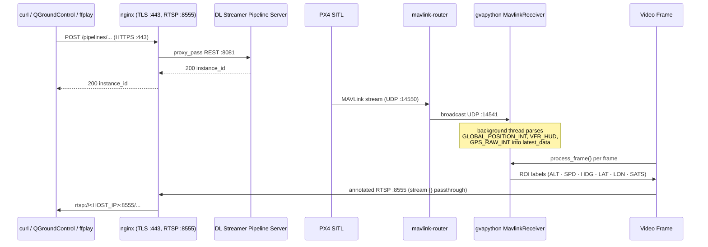

<!--
SPDX-FileCopyrightText: (C) 2026 Intel Corporation
SPDX-License-Identifier: Apache-2.0
-->

# Get Started (Standalone Mode / Pymavlink)

This guide provides a step-by-step walkthrough for testing the UAV Vision Analytics application in standalone mode (Pymavlink) and running the demo with a simulated UAV camera feed/RealSense cameras.

## How It Works

A self-contained stack. PX4 SITL, MAVLink router, MQTT broker, and Metrics Manager are all started together (`docker-compose-pymavlink.yml`). Telemetry flows from PX4 SITL through `mavlink-router` to the DL Streamer container, where `pymavlink` reads it directly over UDP.


**Telemetry flow:**



**Services:**

| Service | Image | Ports | Role |
| --- | --- | --- | --- |
| `dlstreamer-pipeline-server` | `intel/dlstreamer-pipeline-server` + Pymavlink | `8081`, `8555` | AI inference, RTSP output |
| `broker` | `eclipse-mosquitto` | `1883` (published through `nginx`) | MQTT broker for the scene captions |
| `px4` | `px4io/px4-sitl` | `14550` | Flight controller simulator |
| `mavlink-router` | custom build | `14551` (UDP, published to `HOST_IP`) | MAVLink UDP routing (:14550 → :14541); remote QGroundControl connects to :14551 |
| `metrics-manager` | `intel/metrics-manager` | `9090` | CPU/GPU/NPU/power metrics |
| `nginx` | `nginx:1.27-alpine` | `80` (redirects to 443), `443` (HTTPS, self-signed cert), `8555` (RTSP passthrough) — published to `HOST_IP` | Reverse proxy / TLS termination — publishes the web, RTSP, and MQTT ports to the host |

> [!CAUTION]
> `dlstreamer-pipeline-server` and `metrics-manager` no longer publish ports directly —
  both are reachable only through `nginx` on the internal `app_network`.

---

## Steps to Test the Application

### System Requirements

See [System Requirements](./system-requirements.md) for the full list of software and hardware prerequisites.

### 1. Configure environment

There are two options available to get the application source:

<!-- markdownlint-disable MD036 -->
<!--hide_directive ::::{tab-set} hide_directive-->
<!--hide_directive :::{tab-item} hide_directive--> **Download the ZIP (recommended)**
<!--hide_directive :sync: zip hide_directive-->

Download the compressed file and get into the directory:

```bash
curl -OjL https://github.com/open-edge-platform/federal-and-aerospace-ai-suite/releases/download/fedaero-latest/uav-mission-apps.zip
```

Decompress the downloaded file:

```bash
unzip uav-mission-apps.zip
cd uav-vision-analytics
```

<!--hide_directive ::: hide_directive-->
<!--hide_directive :::{tab-item} hide_directive--> **Clone the repository**
<!--hide_directive :sync: clone hide_directive-->

Clone the repository and get into the directory:

```bash
git clone https://github.com/open-edge-platform/federal-and-aerospace-ai-suite.git --branch main
cd federal-and-aerospace-ai-suite/uav-vision-analytics
```

<!--hide_directive
:::
::::
hide_directive-->
<!-- markdownlint-enable MD036 -->

Then, for either option, initialize the environment:

```bash
make init
```

`make init` creates `.env` from the template and auto-detects your **host IP** (`HOST_IP`, used for the RTSP, MQTT, and HTTPS addresses), your **Intel GPU device paths** (`GPU_DEVICE`, `GPU_RENDER_DEVICE`), **Intel NPU** (`NPU_DEVICE`), and **RealSense / USB camera** (`CAMERA_DEVICE_1`). It skips if `.env` already exists. Open and update `.env` only if `HOST_IP` is not the address other machines use to reach this host (for example on a host with several network cards).

### 2. Prepare the models

Download and export the YOLO11s detection model to OpenVINO™ FP16 IR:

```bash
make model
```

Download and convert the VLM that writes the scene captions (InternVL2-1B, OpenVINO™ IR for the CPU and the GPU). The shipped `configs/cameras-pymavlink.yaml` turns captions on for two cameras, so this step is needed for the default setup:

```bash
make vlm-model
```

Both targets show the model license and ask for confirmation; add `ACCEPT_LICENSE=y` to accept without the prompt.

> See the [AI Model guide](../how-to-customize/model-and-video-management/model.md) and the [VLM Model guide](../how-to-customize/model-and-video-management/vlm-model.md) for model details.

### 3. Standalone mode (Pymavlink)

```bash
make pymav-up
```

### 4. Start inference pipelines

Two options are available depending on your use case:

#### Option A — Managed RTSP output (recommended)

Runs `pipeline_manager.py` inside the DL Streamer Pipeline Server container. It monitors the drone's ARMED/DISARMED state and automatically starts and stops inference pipelines. Annotated frames are served as RTSP on port `8555`.

`make start-rtsp` starts the cameras listed in [`configs/cameras-pymavlink.yaml`](https://github.com/open-edge-platform/federal-and-aerospace-ai-suite/blob/main/uav-vision-analytics/configs/cameras-pymavlink.yaml): one pipeline per camera, each streaming on `rtsp://<HOST_IP>:8555/uav-<camera>`. The shipped file has three cameras (`front_camera`, `bottom_camera`, `back_camera`) with detection on the NPU and scene captions from the VLM on the GPU. Edit the file to choose the video, the detection and captioning devices and models, the prompt, and the overlay of each camera, see [Configure the Cameras](../how-to-customize/camera-management/configure-cameras.md):

```bash
make check-cameras     # validate configs/cameras-pymavlink.yaml and show what would run (nothing is started)
make start-rtsp        # start the cameras when the vehicle is armed (the file is re-read at every arming)
make cameras-status    # compare the file with the running pipelines
```

> [!TIP]
> To arm the drone and trigger streaming, connect with QGroundControl (QGC) and press takeoff
> — see the [QGroundControl guide](../how-to-guides/qgroundcontrol.md) for setup and connection
> details. Every enabled camera in `configs/cameras-pymavlink.yaml` starts together once armed
> — see [Step 5 — View the output stream](#5-view-the-output-stream) for the RTSP URLs.
>
> To run the cameras right away, without arming the drone, use `pipeline_manager.py --start-now`,
> see [Starting pipelines without arming the drone](https://github.com/open-edge-platform/federal-and-aerospace-ai-suite/blob/main/uav-vision-analytics/README.md#starting-pipelines-without-arming-the-drone).

#### Option B — Manual REST API

Start a single pipeline directly without the pipeline manager. Useful for testing individual pipelines or custom configurations. The pipeline is chosen by name (`uav_object_detection_<det>` for detection only, `uav_object_detection_<det>_<vlm>` with captions, see [Configure the Cameras](../how-to-customize/camera-management/configure-cameras.md)); everything in `parameters` is optional and defaults to the pipeline's own values.

```bash
# detection on the GPU, no captions
INSTANCE_ID=$(curl -k -s -X POST \
  https://<HOST_IP>/pipelines/user_defined_pipelines/uav_object_detection_gpu \
  -H "Content-Type: application/json" \
  -d '{
    "destination": {
      "frame": {"type": "rtsp", "path": "uav-my-camera", "encoding": "h264"}
    },
    "parameters": {
      "video": "uav_sample_bottom.avi"
    }
  }' | tr -d '"')
echo "Instance ID: $INSTANCE_ID"
```

> [!TIP]
> **Useful request values**: the pipeline name picks the detection device (and the VLM device); `destination.frame.path` is the stream name; `destination.frame.overlay: false` hides the boxes and the telemetry text; `parameters.video`, `detection_model`, `captioner_model_path`, `captioner_prompt`, and `mqtt_topic` (captioning pipelines) override the defaults. To keep a per-frame detection log, add `"metadata": {"type": "file", "path": "/tmp/results.jsonl", "format": "json-lines"}` to `destination`.

### 5. View the output stream

#### View with ffplay

Install ffmpeg first if not present using `sudo apt install ffmpeg`.

Any of the annotated streams can be viewed with `ffplay <RTSP_PATH>`:

```bash
ffplay rtsp://<HOST_IP>:8555/uav-front-camera   # one stream per camera of configs/cameras-pymavlink.yaml
ffplay rtsp://<HOST_IP>:8555/uav-bottom-camera
ffplay rtsp://<HOST_IP>:8555/uav-back-camera
```

#### View scene captions

Cameras with captioning on publish a caption on the MQTT topic `uav/caption/<camera>`:

```bash
mosquitto_sub -h <HOST_IP> -t uav/caption/front_camera
```

The annotated stream includes bounding boxes for detected objects
(person, car, bus, truck, bicycle, and other classes)
and a live telemetry overlay (GPS, altitude, speed, heading).

> [!NOTE]
> Other ways to view the stream:
>
> - Leverage versatile streaming media players such as VLC Player to seamlessly handle, manage, and playback the incoming streams with ease and efficiency.
> - **QGroundControl (QGC)** — connect and view the stream directly in its video panel; see the [QGroundControl guide](../how-to-guides/qgroundcontrol.md#rtsp-stream) for connection details. For the [Step 4](#4-start-inference-pipelines)-Option A flow, connecting QGC and pressing takeoff is arms the drone and triggers the pipeline manager to starts the selected pipeline and serves the RTSP stream once the UAV is armed. If the UAV is armed without a takeoff command, PX4 SITL automatically disarms it again after a few seconds.
> - Cameras with detection on the NPU need `NPU_DEVICE` to have been detected during `make init`; otherwise the manager skips them and says so.

**Stop an individual pipeline** (only needed if you started one manually via Option B in [Step 4](#4-start-inference-pipelines)):

```bash
curl -k -X DELETE https://<HOST_IP>/pipelines/${INSTANCE_ID}
```

### 6. Stop all services

Stop and remove the standalone Pymavlink stack (also removes named volumes):

```bash
make pymav-down
```

---

## Pipelines

### Pymavlink mode (`config-pymavlink.json`)

| Pipeline | Detection | Captions (VLM) | Source |
| --- | --- | --- | --- |
| `uav_object_detection_<det>` | `cpu`, `gpu` or `npu` | no | Looped video file in `resources/videos` |
| `uav_object_detection_<det>_<vlm>` | `cpu`, `gpu` or `npu` | `cpu` or `gpu` | Looped video file |
| `uav_camera_npu`, `uav_camera_npu_gpu` | `npu` | none / `gpu` | Live camera (RealSense or USB webcam) |

All of them publish RTSP on `:8555`. The camera pipelines for the CPU and GPU are in `configs/config-pymavlink-realsense.json`.
`make start-rtsp` picks the pipeline for each camera in `configs/cameras-pymavlink.yaml`
([Configure the cameras](../how-to-customize/camera-management/configure-cameras.md)).

> [!NOTE]
> **Using different or your own aerial footage:** each camera of `configs/cameras-pymavlink.yaml` plays its own file from `resources/videos/` (`uav_sample_front.avi`, `uav_sample_bottom.avi`, `uav_sample_back.avi`). Convert your footage with `scripts/convert_video.sh` and set `video:` for the camera, see [Use Your Own Videos](../how-to-customize/model-and-video-management/use-your-own-video.md). The file is only read when a pipeline starts, so there is no need to stop the stack: restart the cameras (`make start-rtsp`, or disarm and arm again).

---

## Telemetry Overlay Fields

Each output frame carries these overlaid fields in the upper-left corner:

| Field | Source MAVLink message | Description |
| --- | --- | --- |
| `Name` | — | Name passed as argument to the gvapython |
| `Frame` | — | Running frame counter |
| `ALT` | `GLOBAL_POSITION_INT.relative_alt` | Relative altitude (m) |
| `SPD` | `VFR_HUD.groundspeed` | Ground speed (m/s) |
| `HDG` | `GLOBAL_POSITION_INT.hdg` | Heading (degrees) |
| `LAT` | `GPS_RAW_INT.lat` | Latitude |
| `LON` | `GPS_RAW_INT.lon` | Longitude |
| `SATS` | `GPS_RAW_INT.satellites_visible` | GPS satellites visible |

---

## Port Reference

`nginx` and `mavlink-router` (UDP `14551`, for a remote QGroundControl) are the only services that
publish ports to the host (bound to `HOST_IP`, not `0.0.0.0`). Everything else below is reachable
only on the internal `app_network`.

| Port | Protocol | Service | Published to host? | Mode |
| --- | --- | --- | --- | --- |
| `80` | HTTP | `nginx` → `301` redirect to HTTPS (no application traffic) | Yes | All modes |
| `443` | HTTPS | `nginx` → proxies to `dlstreamer-pipeline-server:8081` (REST API) and `metrics-manager:9090` (metrics); self-signed cert, use `curl -k` | Yes | All modes |
| `8555` | RTSP | `nginx` → raw TCP passthrough to `dlstreamer-pipeline-server:8555` | Yes | All modes |
| `8081` | HTTP | DL Streamer REST API | No (internal only) | All modes |
| `1883` | MQTT | `nginx` → raw TCP passthrough to `broker:1883` (scene captions `uav/caption/<camera>`) | Yes | Pymavlink modes |
| `14551` | UDP | `mavlink-router` MAVLink endpoint for a remote QGroundControl (see [QGroundControl](../how-to-guides/qgroundcontrol.md)) | Yes | Pymavlink modes |
| `14541` | UDP | MAVLink broadcast (mavlink-router) | No (internal only) | Pymavlink modes |
| `9090` | HTTP | metrics-manager (HW metrics) | No (internal only) | Pymavlink modes |

---

## RealSense Camera Support

RealSense camera setup and pipelines details are provided in the [RealSense guide](../how-to-customize/camera-management/realsense-guide.md).

## Documentation

| Document | Description |
| --- | --- |
| [index.md](../index.md) | Application overview and component block diagrams |
| [how-to-guides.md](../how-to-guides.md) | Operating the application: QGroundControl, ground station, deployment modes |
| [how-to-customize.md](../how-to-customize.md) | Changing cameras, models, pipelines, overlay and search tuning |
| [benchmark.md](../benchmark.md) | Performance benchmarking guide |
| [makefile.md](../how-to-guides/makefile.md) | Makefile target reference |
| [troubleshooting.md](../how-to-guides/troubleshooting.md) | Known issues and resolutions |
