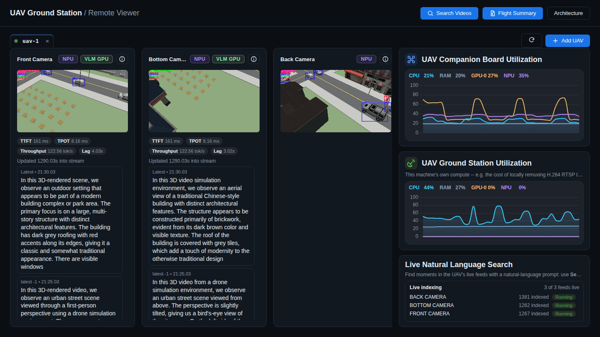
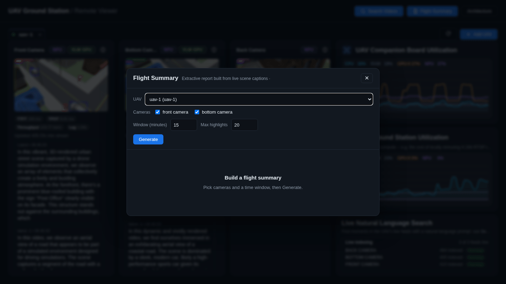

# Get Started

This guide walks through deploying `uav-ground-station` end to end: the UAV side it
connects to, the base viewer, the optional VSS search overlay, multi-UAV use,
and the Flight Summary report. See [Configuration](configuration.md) for the
full `.env` variable reference.

## Deploy the UAV Side First

`uav-ground-station` is a remote *viewer* — it has nothing to show until a
UAV host is already running pipelines it can connect to. Deploy one of these
first, on a **different machine** than this one:

- For standalone (pymavlink) mode: deploy
  [`uav-vision-analytics`](https://github.com/open-edge-platform/federal-and-aerospace-ai-suite/blob/main/uav-vision-analytics/README.md)
  following its
  [Deploy in Standalone Mode](../uav-vision-analytics/deploy/deploy-standalone.md)
  guide.
- For SDK mode: deploy
  [`uav-mission-compute-sdk`](https://github.com/open-edge-platform/federal-and-aerospace-ai-suite/blob/main/uav-mission-compute-sdk/README.md)
  first, then `uav-vision-analytics` on top of it following
  [Deploy in UAV Mission Compute SDK Mode](../uav-vision-analytics/deploy/deploy-uavsdk.md)
  — the Mission Compute SDK alone has no camera pipelines or
  `/pipelines/status` API for this viewer to connect to; `uav-vision-analytics`
  is what actually provides those in both modes.

Either way, come back here once at least one camera pipeline is `RUNNING`.

You will need that host's IP address in the next section.

## Get the Ground-Station Source

There are two options to get the application source first:

### Option A — Download the ZIP (Recommended)

```bash
curl -OjL https://github.com/open-edge-platform/federal-and-aerospace-ai-suite/releases/download/fedaero-latest/uav-mission-apps.zip
unzip uav-mission-apps.zip
cd uav-ground-station
```

### Option B — Clone the Whole Repository

```bash
git clone https://github.com/open-edge-platform/federal-and-aerospace-ai-suite.git --branch main
cd federal-and-aerospace-ai-suite/uav-ground-station
```

Then, for either option:

```bash
make up      # creates .env from template (host IP and devices auto-detected), builds, and starts the container
```

`make up` runs `make init`, which sets `VIZ_HOST_IP` and `VIZ_PUBLIC_HOST` to this
machine's LAN IP and detects the GPU/NPU devices; edit `.env` only to override them
(for example `127.0.0.1` for loopback-only access).

> [!NOTE]
> `make up` starts only the viewer + mediamtx relay (video, captions, metrics,
> Flight Summary) — the **Search Videos** button and `/api/search*` stay
> hidden/`404` until the separate VSS overlay is started with `make up-vss`
> *instead of* `make up` (it is not a flag to `make up`). See
> [VSS Search](#vss-search) below for the extra `.env` variables it needs
> and exactly what `make up-vss` adds.\
> `make up-vss` always includes everything `make up` does (viewer + mediamtx + the 8 VSS
> containers), so you only ever run one or the other, not both.\
> Started with plain `make up` and want Search later? Just run `make up-vss`
> — it brings up the same viewer/mediamtx containers (unchanged, so this is
> fast) plus the missing VSS ones, in place.\
> Dashboard, video, captions, Flight Summary, and per-host metrics work the
> same either way — only Search Videos depends on which one you ran. Tear
> down with the matching command: `make down` after `make up`, `make down-vss`
> after `make up-vss` (see the [!IMPORTANT] note below `make down`).

> [!NOTE]
> `make up` and `make up-vss` check the ports this stack publishes (`VIZ_PORT`,
> `MEDIAMTX_WEBRTC_PORT`, the WebRTC ICE ports, and `VSS_MANAGER_PORT`) and move any
> that another process on this machine already uses to the next free port, saved
> in `.env`; the dashboard URL printed at the end uses the result. The UAV Mission
> Compute SDK publishes `8080` (REST), `8554` (RTSP), `8888` (HLS), and `8889`
> (WebRTC), so on a machine with the SDK installed the ground station takes
> `8081` and `8890` instead, and never one of those four, even while the SDK is
> stopped. Running the SDK and the ground station on separate machines is the
> intended setup; if you start the ground station first and install the SDK
> afterwards, the SDK's own `make` fails on the ports the ground station holds, so
> start the SDK first or set different ports in `.env` yourself.

Then open `http://<VIZ_HOST_IP>:<VIZ_PORT>` (default port `8080`; `http://localhost:<VIZ_PORT>` when `VIZ_HOST_IP` is `127.0.0.1`), enter the
UAV host's IP from
[Deploy the UAV Side First](#deploy-the-uav-side-first) (defaults to
`VIZ_COMPANION_HOST`, `127.0.0.1`), and press **Connect**. Device cards
(`cpu`/`gpu`/`npu`) are detected automatically from whichever pipelines are
currently running on the remote host.

```bash
make down    # stop and remove the stack started with make up
make logs    # tail the container's logs
```

> [!IMPORTANT]
> If you started with `make up-vss`, tear down with `make down-vss` (or
> `make clean-vss-index` / `make delete-vss-volumes` — see
> [VSS Search](#vss-search)), not plain `make down`: `make down` only
> targets `docker-compose.yml` + `docker-compose-mediamtx.yml` and leaves
> the 8 `uav-gs-vss-*` containers from `docker-compose-vss.yml` running.

## VSS Search

The **Live Natural Language Search** panel and **Search Videos** popup appear
only when the VSS overlay is used. It is a separate compose file,
`docker-compose-vss.yml`, that adds just the 8 containers VSS search needs
(pipeline-manager, video-search, multimodal-dataprep,
multimodal-embedding-serving, vector-retriever, vdms-vector-db, postgres,
minio; container names `uav-gs-vss-*`). With the default `make up` the search UI is hidden
and the search routes return 404.



1. `make init` (run once, on first setup) already takes care of auto-generating
   the `VSS_MINIO_*` / `VSS_POSTGRES_*` credentials (a fixed username and a
   random password — these are internal to this stack's own MinIO/Postgres
   containers only, never exposed outside the docker network). For
   `VSS_EMBEDDING_MODEL` / `DATAPREP_DETECTION_MODEL` it shows the two
   Hugging Face models that would be downloaded (and their license pages) and
   asks for confirmation — nothing is downloaded or pre-filled into `.env`
   without saying yes.

   Only edit `.env` by yourself if you want different credentials or
   declined the model prompt — see `.env.example` for the full set of VSS
   variables (optional devices included):

   ```bash
   VSS_MINIO_USER=vss-admin
   VSS_MINIO_PASSWORD=<random characters>
   VSS_POSTGRES_USER=vss
   VSS_POSTGRES_PASSWORD=<random characters>
   VSS_EMBEDDING_MODEL=CLIP/clip-vit-b-32
   DATAPREP_DETECTION_MODEL=OpenVINO/yolox_s-int8-ov
   ```

   > [!IMPORTANT]
   > `DATAPREP_DETECTION_MODEL` must be a Hugging Face **OpenVINO™ Model API**
   > repository under the `OpenVINO/` namespace (`OpenVINO/yolox_s-int8-ov` above).
   > If `.env` was created by hand instead of via `make init` and any of the
   > six `VSS_MINIO_*`/`VSS_POSTGRES_*`/`VSS_EMBEDDING_MODEL`/
   > `DATAPREP_DETECTION_MODEL` variables are left blank, `make up-vss` fails fast
   > with one message listing everything missing (MinIO also needs a user of
   > at least 3 and a password of at least 8 characters, or its container
   > keeps restarting).
2. `make up-vss` (base + mediamtx + VSS overlay; use this instead of plain
   `make up` whenever Live Natural Language Search is wanted — `make up`
   alone never starts the 8 VSS containers or exposes the Search UI). The
   first start downloads the CLIP embedding model (and the YOLOX detection
   model, for object crops) into Docker volumes.

   By default every VSS device (`VSS_INGEST_EMBEDDING_DEVICE`,
   `VSS_DETECTION_DEVICE`, `VSS_QUERY_EMBEDDING_DEVICE`) runs on `CPU`. Pick a
   different device for all three at once, at deploy time, without
   hand-editing `.env`:

   ```bash
   make up-vss DEVICE=GPU    # or NPU, CPU
   make up-vss DEVICE=all    # auto-pick the best hardware 'make init' already detected
   ```

   `DEVICE=all` prefers GPU, then NPU, then CPU, based on whatever
   `GPU_DEVICE`/`NPU_DEVICE` `make init` already found on this host. Omit
   `DEVICE` entirely to leave whatever is currently in `.env` untouched. See
   [Configuration](configuration.md) if you want ingest, detection, and query
   embedding to each run on a different device instead of all three matching.
3. Open the dashboard and **Connect** to the UAV. Every RUNNING pipeline
   (`uav-<camera>` on `VIZ_REMOTE_RTSP_PORT`) is registered with VSS
   as a live stream and indexed continuously. A backend loop
   (`VSS_LIVE_SYNC_INTERVAL_SECONDS`) adds pipelines that start later and
   pauses ones that stop; **Disconnect** pauses all of them. Indexed footage
   is kept for `VSS_LIVE_RETENTION_HOURS`.

`make down-vss` stops everything but keeps the index; `make clean-vss-index`
also deletes the indexed footage, embeddings, and stream registrations but
keeps the downloaded models; `make delete-vss-volumes` (asks for confirmation;
`FORCE=1` skips it) deletes all VSS volumes, including the models
(re-downloaded on the next start). The pipeline-manager API is published on
`VIZ_HOST_IP:VSS_MANAGER_PORT` (default 3001) for uploading videos
(`POST /videos`, then `POST /videos/search-embeddings/<videoId>`).

Live RTSP ingestion needs the `intel/*:2026.3.0` (or newer) VSS images
(`VSS_REGISTRY` / `VSS_TAG`). To use a VSS
deployed separately with its own `setup.sh --search` instead, set
`VSS_ENABLED=true` and `VSS_MANAGER_URL` / `VSS_DATASTORE_URL` in `.env`.

> [!NOTE]
> Stale or orphaned VSS streams (for example from a UAV host that was
> redeployed under a new IP, or test footage that is no longer connected)
> keep their already-indexed data searchable even after the dashboard stops
> tracking them. Because VSS returns its global best matches before any
> per-UAV/per-camera filtering is applied, a large stale index can dominate
> search results for UAVs/cameras that are actually connected right now. Run
> `make clean-vss-index` (keeps downloaded models, re-indexes from scratch on
> next connect) if you want to clear that out, or see
> [Configuration](configuration.md)'s `VSS_MAX_RESULTS` entry for how result
> counts are capped per query.

See [Configuration](configuration.md#backend-routes) for the full proxy route
reference, including a quick `curl` check.

### Multiple UAVs at Once

The dashboard supports connecting to more than one UAV companion board in the
same browser session: a tab bar appears above the connect field once a second
host is connected, and switching tabs swaps which host's camera cards and
metrics are shown. Disconnecting (closing a tab's **×**) stops that host's VSS
live-sync indexing; switching tabs does not — a host keeps being indexed in
the background for as long as its tab stays open, even while another tab is
active.

Because camera names are operator-chosen (`configs/cameras-*.yaml`), two UAVs
could configure the same camera name (for example, both have a `uav-front-camera`);
each host's streams are registered with VSS under a host-qualified name
(`uav-<host>--<camera>`) so they never collide.

Each search result's `camera`/`host` fields are resolved in order from: the
embedding's own `sensor_id` metadata; failing that, the stream's
registration-time `tags` (`["uav", "<host>", "<camera>"]`, also visible in
each result's own "Tags" detail); and failing that, looking the result's
`video_id` up in VSS's current stream list as a last resort. A result VSS
still has indexed from a UAV that has since disconnected may still show
"Unknown camera" if none of these resolve.

The dashboard's search popup puts two filter controls: UAV and Camera dropdowns.
The full, unfiltered result set is fetched once when the search runs, and every
subsequent filter toggle — whether switching UAVs, changing cameras, or resetting
selections — simply reshapes that same in-memory dataset without firing any
additional network request.

Clips whose codec the browser cannot decode (for example some stored
live-stream segments) fall back to VSS's
server-decoded best-matching frame plus a download link. Live segments older
than VSS's `LIVE_RETENTION_HOURS` may no longer be available.

## Flight Summary

The **Flight Summary** button (top bar) opens a report built from the MQTT
scene-caption stream (`uav/caption/<camera>`) — the same captions shown live
under each camera's video. It works independently of VSS: no extra containers,
no LLM call, always available once a camera's pipeline is running with
captioning on.



1. `uav-gs-backend` keeps a small ring buffer of recent captions per
   `(host, camera)` (`caption_log.py`), kept warm only while the dashboard's
   normal pipeline-info polling has observed that camera captioning; an idle
   `(host, camera)` pair is dropped after `CAPTION_LOG_IDLE_TTL_SECONDS`.
2. Open **Flight Summary**, confirm the host (defaults to the connected UAV),
   pick one or more cameras from the list (populated from whichever cameras
   are currently captioning) and a time window, then **Generate**.
3. `vss_summary.py` runs an extractive map-reduce over that camera's buffered
   captions: consecutive near-identical captions are folded into one "scene"
   (with an occurrence count), a keyword tally feeds the overview paragraph,
   and a representative subset of scenes (favoring long-held/repeated ones,
   filled out with an even chronological spread of the rest) is kept per
   camera up to the requested highlight budget. With more than one camera
   selected, the timeline is **grouped by camera** — all of one camera's
   highlights in order, then the next camera's — rather than interleaved by
   arrival time, which is hard to follow once several cameras are captioning
   concurrently.
4. **Download PDF** renders the same report via `pdf_writer.py` (a small,
   dependency-free PDF writer — no extra system packages).

If a search was just run, the report also appends the query and its matched
clips as an "appendix", tying a natural-language search back to the raw
caption evidence around the same time window.

See [Configuration](configuration.md#flight-summary) for the report's route
reference.

## Troubleshooting and Related Guides

The UAV Vision Analytics user guide covers the problems that show up on both
sides of this setup:

- [Troubleshooting](../uav-vision-analytics/troubleshooting.md)
  — port clashes with the UAV Mission Compute SDK, cameras that skip or lose
  their streams, VSS search and live-index behavior, and the multi-UAV ground
  station.
- [Monitor Multiple UAVs in the Ground Station](../uav-vision-analytics/how-to-guides/multi-uav-ground-station.md)
  — the same multi-UAV walkthrough, from the UAV side.
- [VSS Live Search](../uav-vision-analytics/how-to-guides/vss-live-search.md)
  and [Search Tuning](../uav-vision-analytics/how-to-customize/search-tuning/vss-search-tuning.md)
  — the same search setup, with tuning of the `VSS_SEARCH_*` variables.
- [Configure the Cameras](../uav-vision-analytics/how-to-customize/camera-management/configure-cameras.md)
  — the camera files that decide which cards, captions, and devices the
  dashboard shows.

If a card stays without video after the cameras on the UAV host were stopped and
started again right away, restart the pipeline server there
(`docker restart uav-va-dlstreamer-pipeline-server`) and start the cameras
again; see the known issues in the [Release Notes](release-notes.md).
