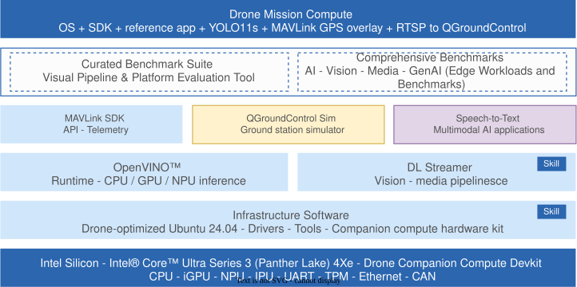

# UAV Vision Analytics

<!--hide_directive

  <a class="icon_github" href="https://github.com/open-edge-platform/federal-and-aerospace-ai-suite/tree/main/uav-vision-analytics">
     GitHub
  </a>
  <a class="icon_document" href="https://github.com/open-edge-platform/federal-and-aerospace-ai-suite/blob/main/uav-vision-analytics/README.md">
     Readme
  </a>
  <a class="icon_download" href="https://github.com/open-edge-platform/federal-and-aerospace-ai-suite/releases/tag/fedaero-latest">
     Download Package
  </a>

hide_directive-->

UAV Vision Analytics demonstrates how AI-based object detection can be integrated with
Uncrewed Aerial Vehicle (UAV) flight controller telemetry on a companion compute platform.

The application runs YOLO11s, the pretrained small object detection model from Ultralytics.
Each camera pipeline can optionally also run a Vision-Language Model (VLM) alongside
detection to publish natural-language scene captions over MQTT.

The application supports two deployment modes, depending on whether an external SDK is
available:

- [Standalone Mode (Pymavlink)](./deploy/deploy-standalone.md): a self-contained
  mode that uses PX4 SITL simulation and Pymavlink for MAVLink communication. No external
  dependencies are required.
- [UAV Mission Compute SDK Mode](./deploy/deploy-uavsdk.md): an integration mode
  that connects to a running instance of the UAV Mission Compute SDK, enabling full mission
  control and multi-camera pipeline management.

Pair it with the [UAV Ground Station](../uav-ground-station/index.md) to view the live video,
scene captions, and host utilization from a separate machine.

<!--hide_directive
:::{toctree}
:hidden:

Install UAV Vision <./install-uav-app.md>
Installation on Ubuntu <./installation-on-ubuntu.md>
How-To Guides <./how-to-guides.md>
Customize UAV Vision <./how-to-customize.md>
Troubleshooting <./troubleshooting.md>

:::
hide_directive-->